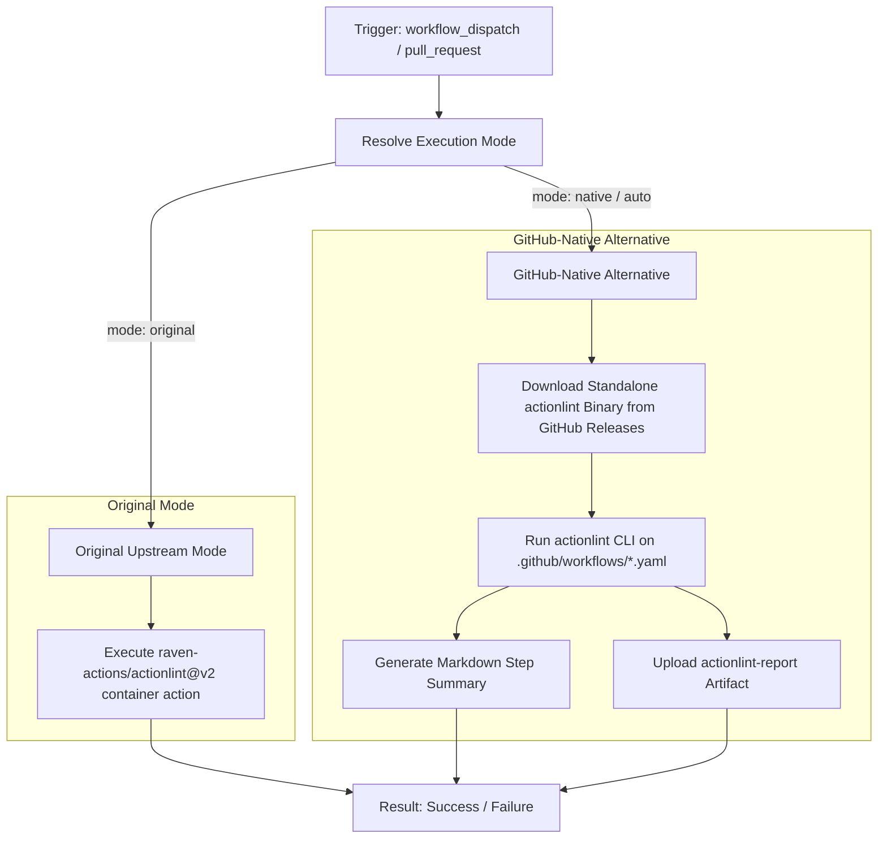

# Actionlint Workflow Modernization Report

## Section 1: Overview & Purpose

The `Lint Action Workflows` pipeline (`.github/workflows/actionlint.yaml`) provides static analysis and syntax validation for all GitHub Actions workflow files within `.github/workflows/`.

### Why it Needed Adaptation
- **Missing On-Demand Triggers**: Upstream only triggered on `pull_request` when workflow files changed. It lacked `workflow_dispatch`, preventing developers from verifying workflow syntax on demand or validating workflows in private/forked repositories.
- **Hardcoded Runner Architecture**: Upstream was hardcoded to `runs-on: ubuntu-24.04`, preventing execution on custom self-hosted or organization-specified runners.
- **Lack of Dual-Mode Fallback**: Upstream relied exclusively on the third-party container action `raven-actions/actionlint@v2`. If Docker pulling or container runtime initialization encounters issues or rate limits, the entire check fails without an alternative.
- **Zero Visibility & Artifacts**: Upstream emitted logs only to standard output and did not persist lint analysis reports or structured step summaries.

---

## Section 2: Dual-Mode Architecture & Changes Summary



### Key Changes Made
1. **Added `workflow_dispatch` trigger** with configurable parameters:
   - `mode`: `auto` (default), `native`, `original`
   - `runner`: Custom runner label (defaulting to `vars.RUNNER_LABEL || 'ubuntu-24.04'`)
   - `shellcheck`: Flag to enable/disable embedded shell script linting
   - `pyflakes`: Flag to enable/disable embedded python linting
2. **Dynamic Runner Selection**: Replaced static `ubuntu-24.04` with `${{ inputs.runner || vars.RUNNER_LABEL || 'ubuntu-24.04' }}`.
3. **Dual-Mode Engine**:
   - **Original Mode**: Preserves upstream behavior via `raven-actions/actionlint@3d39aea434753780c3b3d4a1a31c854b4dbf49d7`.
   - **Native Alternative**: Directly installs and runs the official standalone `actionlint` binary, eliminating Docker daemon overhead, supporting arbitrary runner architectures, and generating structured step summaries.
4. **Artifact Archival**: Added `actions/upload-artifact@v4` step to capture `actionlint-report.txt` for auditability.
5. **Modernized Actions**: Migrated checkout to `actions/checkout@v4`.

---

## Section 3: Existing Solutions vs. Free Alternatives Analysis

| Feature / Dimension | Upstream Implementation | GitHub-Native Dual-Mode Alternative |
|---|---|---|
| **Trigger Support** | `pull_request` only | `pull_request` + `workflow_dispatch` manual trigger |
| **Runner Infrastructure** | Hardcoded `ubuntu-24.04` | `${{ inputs.runner \|\| vars.RUNNER_LABEL \|\| 'ubuntu-24.04' }}` |
| **Lint Engine** | Containerized `raven-actions/actionlint@v2` | Dual-mode: Native standalone binary OR `raven-actions` container |
| **Container Dependency** | Requires Docker daemon / container runtime | Native mode runs without Docker dependencies |
| **Artifact Generation** | None | Generates and uploads `actionlint-report` artifact |
| **Summary Reporting** | None (stdout only) | Rich GitHub Actions Markdown step summary |
| **Cost & Licenses** | 100% Free | 100% Free |

---

## Section 4: Configuration & Data Requirements

### Repository Secrets
*No repository secrets are required.*

| Secret Name | Required / Optional | Description |
|---|---|---|
| N/A | None | Workflow operates solely using read permissions |

### Repository Variables

| Variable Name | Required / Optional | Default Value | Description |
|---|---|---|---|
| `RUNNER_LABEL` | Optional | `ubuntu-24.04` | Custom runner label to override standard runner |

### Permissions Required

| Scope | Permission Level | Reason |
|---|---|---|
| `contents` | `read` | Clone and read workflow files from repository |

---

## Section 5: Live Test Verification Details

*(Pending live test execution)*

---

## Section 6: How to Test Later

### Using GitHub CLI (`gh`)
```bash
# Run in default auto mode
gh workflow run actionlint.yaml --ref main

# Run in native mode with shellcheck enabled
gh workflow run actionlint.yaml --ref main -f mode=native -f shellcheck=true

# Run in original upstream mode
gh workflow run actionlint.yaml --ref main -f mode=original
```

### Using Python Dispatch Script
```python
import os
import requests

GITHUB_TOKEN = os.getenv("GH_TOKEN") or os.getenv("GITHUB_TOKEN")
REPO = os.getenv("GITHUB_REPOSITORY", "sajuptpm/k3s")

headers = {
    "Authorization": f"Bearer {GITHUB_TOKEN}",
    "Accept": "application/vnd.github.v3+json",
}

payload = {
    "ref": "main",
    "inputs": {
        "mode": "native",
        "shellcheck": "false",
        "pyflakes": "false"
    }
}

res = requests.post(
    f"https://api.github.com/repos/{REPO}/actions/workflows/actionlint.yaml/dispatches",
    headers=headers,
    json=payload
)
print(f"Status: {res.status_code}")
```

---

## Section 7: Step-by-Step GitHub UI Manual Verification Guide

1. Navigate to the GitHub repository: `https://github.com/sajuptpm/k3s`.
2. Click on the **Actions** tab in the top navigation bar.
3. In the left sidebar, click on **Lint Action Workflows**.
4. Click the **Run workflow** dropdown button on the right.
5. Configure inputs:
   - **Branch**: Select `main`.
   - **Execution mode**: Select `native` (or `auto` / `original`).
   - **Custom runner label**: Leave blank or specify custom runner.
   - **Run shellcheck / pyflakes**: Check or leave unchecked.
6. Click the green **Run workflow** button.
7. Wait 10-15 seconds, then refresh the page to view the run progress.
8. Click into the run to inspect the job steps:
   - Check **Resolve Execution Mode** to verify mode resolution.
   - Check **actionlint (Native Alternative)** to inspect lint output.
   - Check **Upload Lint Report** to download the `actionlint-report` artifact.
