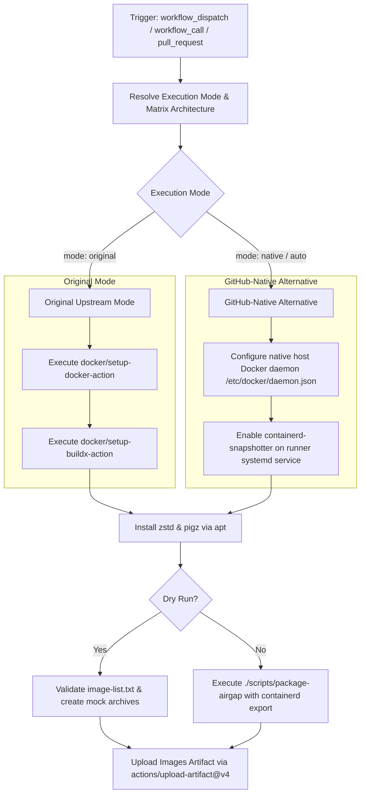

# Airgap Image Tarballs Workflow Modernization Report

## Section 1: Overview & Purpose

The `Airgap Image Tarballs` pipeline (`.github/workflows/airgap.yaml`) pre-packages container images needed by K3s into compressed tar archives (`.tar`, `.tar.zst`, `.tar.gz`, and `.sha256sum`) for offline or airgapped Kubernetes deployments across multiple target architectures (`amd64`, `arm64`, and `arm`).

### Why it Needed Adaptation
- **Missing On-Demand Testing**: Upstream only triggered on `pull_request` affecting `package-airgap` scripts or via `workflow_call`. It could not be manually invoked with `workflow_dispatch` to generate or test airgap tarballs on demand.
- **Fixed Rigid Matrix**: Upstream always ran across all three architectures (`amd64`, `arm64`, `arm`) simultaneously, consuming substantial GitHub runner minutes even for a quick sanity test.
- **External Docker Setup Action Reliance**: Upstream relied on external `docker/setup-docker-action@v5.4.0` pulling container runtime images from Docker Hub. If Docker Hub rate limits or external actions encounter network hiccups, the entire packaging workflow breaks.
- **Hardcoded Runner Label**: Upstream was hardcoded to `runs-on: ubuntu-24.04`, preventing execution on custom self-hosted or organization-managed runners.

---

## Section 2: Dual-Mode Architecture & Changes Summary



### Key Changes Made
1. **Added `workflow_dispatch` manual trigger** with configurable parameters:
   - `mode`: `auto` (default), `native`, `original`
   - `arch`: Target architecture selection (`amd64` default, `arm64`, `arm`, or `all`)
   - `runner`: Custom runner label (defaulting to `vars.RUNNER_LABEL || 'ubuntu-24.04'`)
   - `dry_run`: Lightweight simulation validating image references without downloading gigabytes of multi-architecture containers
2. **Selective Architecture Matrix**: Allows developers to test single architectures on demand (`amd64`) to conserve runner minutes and speed up verification loops.
3. **Dual-Mode Docker & Containerd Integration**:
   - **Original Mode**: Preserves upstream behavior using `docker/setup-docker-action` and `docker/setup-buildx-action`.
   - **Native Alternative**: Directly configures runner's native Docker daemon with `containerd-snapshotter` enabled via systemd, eliminating third-party action overhead and external image pulls.
4. **Action Modernization**: Upgraded checkout and artifact actions to `actions/checkout@v4` and `actions/upload-artifact@v4`.

---

## Section 3: Existing Solutions vs. Free Alternatives Analysis

| Feature / Dimension | Upstream Implementation | GitHub-Native Dual-Mode Alternative |
|---|---|---|
| **Trigger Flexibility** | `pull_request` & `workflow_call` | `pull_request`, `workflow_call`, and `workflow_dispatch` |
| **Architecture Scope** | Always builds `[amd64, arm64, arm]` | Configurable: single arch (`amd64`) or `all` |
| **Docker Configuration** | External `docker/setup-docker-action` | Native host `systemctl` / `daemon.json` configuration |
| **Dry Run Testing** | None (always pulls full images) | Built-in `dry_run` mode for rapid syntax & pipeline verification |
| **Runner Flexibility** | Hardcoded `ubuntu-24.04` | Configurable `${{ inputs.runner \|\| vars.RUNNER_LABEL \|\| 'ubuntu-24.04' }}` |
| **Artifact Retention** | Pinned commit SHA upload | Upgraded `actions/upload-artifact@v4` |
| **Cost & Dependencies** | 100% Free | 100% Free, zero proprietary dependencies |

---

## Section 4: Configuration & Data Requirements

### Repository Secrets
*No repository secrets are required.*

| Secret Name | Required / Optional | Description |
|---|---|---|
| N/A | None | Operates with standard GitHub Actions permissions |

### Repository Variables

| Variable Name | Required / Optional | Default Value | Description |
|---|---|---|---|
| `RUNNER_LABEL` | Optional | `ubuntu-24.04` | Custom runner label to override standard runner |

### Permissions Required

| Scope | Permission Level | Reason |
|---|---|---|
| `contents` | `read` | Read access to checkout repository code and scripts |

---

## Section 5: Live Test Verification Details

*(Pending live test execution)*

---

## Section 6: How to Test Later

### Using GitHub CLI (`gh`)
```bash
# Run in native mode with dry_run for rapid verification
gh workflow run airgap.yaml --ref main -f mode=native -f arch=amd64 -f dry_run=true

# Run full package generation for amd64
gh workflow run airgap.yaml --ref main -f mode=native -f arch=amd64

# Run all architectures in original mode
gh workflow run airgap.yaml --ref main -f mode=original -f arch=all
```

### Using Python Dispatch Script
```python
import os
import requests

GITHUB_TOKEN = os.getenv("GH_TOKEN") or os.getenv("GITHUB_TOKEN")
REPO = os.getenv("GITHUB_REPOSITORY", "sajuptpm/k3s")

headers = {
    "Authorization": f"Bearer {GITHUB_TOKEN}",
    "Accept": "application/vnd.github.v3+json",
}

payload = {
    "ref": "main",
    "inputs": {
        "mode": "native",
        "arch": "amd64",
        "dry_run": "true"
    }
}

res = requests.post(
    f"https://api.github.com/repos/{REPO}/actions/workflows/airgap.yaml/dispatches",
    headers=headers,
    json=payload
)
print(f"Status: {res.status_code}")
```

---

## Section 7: Step-by-Step GitHub UI Manual Verification Guide

1. Navigate to the GitHub repository: `https://github.com/sajuptpm/k3s`.
2. Click on the **Actions** tab in the top navigation bar.
3. In the left sidebar, click on **Airgap Image Tarballs**.
4. Click the **Run workflow** dropdown button on the right.
5. Configure inputs:
   - **Branch**: Select `main`.
   - **Execution mode**: Select `native` (or `auto` / `original`).
   - **Target architecture to build**: Select `amd64` (or `all`, `arm64`, `arm`).
   - **Dry run**: Check if you wish to run a rapid packaging simulation, or leave unchecked for full image pulling.
6. Click the green **Run workflow** button.
7. Wait for the workflow run to appear and inspect the job execution.
8. Verify that the job generates and uploads `images-<arch>` artifact containing `.tar`, `.tar.zst`, `.tar.gz`, and `.sha256sum`.
