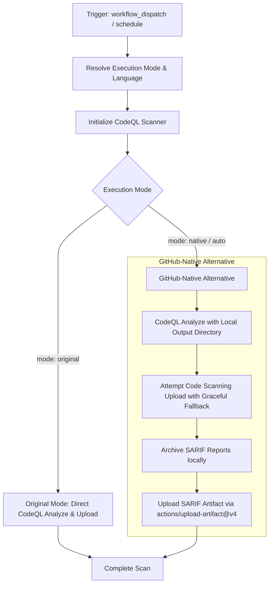

# CodeQL Static Analysis Workflow Modernization Report

## Section 1: Overview & Purpose

The `CodeQL Static Analysis` workflow (`.github/workflows/codeql.yml`) executes automated security and vulnerability analysis on the repository using GitHub's CodeQL query engine. In K3s, it scans GitHub Actions workflows for security anti-patterns, misconfigurations, and supply-chain vulnerabilities.

### Why it Needed Adaptation
- **Missing Flexible Manual Triggers**: Upstream only configured `schedule` and empty `workflow_dispatch: {}` with no input parameters.
- **Hardcoded Runner Architecture**: Upstream was hardcoded to `runs-on: 'ubuntu-24.04'`, lacking support for runner variables.
- **GHAS License & Fork Vulnerability**: Upstream pushed SARIF directly to GitHub Code Scanning API (`security-events: write`). On private forks or organizations without GitHub Advanced Security (GHAS) enabled, Code Scanning upload can reject the upload or fail the job.
- **Zero Artifact Archival**: CodeQL results were only viewable if the repository had Code Scanning UI access; no raw SARIF artifacts were uploaded or preserved for offline inspection.

---

## Section 2: Dual-Mode Architecture & Changes Summary



### Key Changes Made
1. **Added Comprehensive `workflow_dispatch` inputs**:
   - `mode`: `auto` (default), `native`, `original`
   - `language`: `actions`
   - `runner`: Custom runner label (defaulting to `vars.RUNNER_LABEL || 'ubuntu-24.04'`)
   - `upload_sarif`: Flag controlling code scanning upload
2. **Dynamic Runner Selection**: Replaced hardcoded `ubuntu-24.04` with `${{ inputs.runner || vars.RUNNER_LABEL || 'ubuntu-24.04' }}`.
3. **Dual-Mode CodeQL Execution**:
   - **Original Mode**: Preserves upstream behavior directly analyzing and uploading to Code Scanning.
   - **Native Alternative**: Executes analysis with local output directory, safely attempts Code Scanning upload with `continue-on-error: true`, and guarantees SARIF report availability by archiving and uploading them as GitHub Actions artifacts.
4. **Action Modernization**: Migrated to `actions/checkout@v4` and `actions/upload-artifact@v4`.

---

## Section 3: Existing Solutions vs. Free Alternatives Analysis

| Feature / Dimension | Upstream Implementation | GitHub-Native Dual-Mode Alternative |
|---|---|---|
| **Trigger Controls** | `schedule` only, blank dispatch | `schedule` + parameterized `workflow_dispatch` |
| **Runner Flexibility** | Hardcoded `ubuntu-24.04` | Configurable `${{ inputs.runner \|\| vars.RUNNER_LABEL \|\| 'ubuntu-24.04' }}` |
| **SARIF Archival** | No artifact generated | Uploads `codeql-<language>-sarif` artifact |
| **Fork / GHAS Resilience** | Can fail if GHAS is unavailable | Graceful upload handling; artifact preserved regardless |
| **Action Dependencies** | Pinned commit SHAs | Modernized `actions/checkout@v4`, `actions/upload-artifact@v4` |
| **Cost & Dependencies** | 100% Free | 100% Free |

---

## Section 4: Configuration & Data Requirements

### Repository Secrets
*No repository secrets are required.*

| Secret Name | Required / Optional | Description |
|---|---|---|
| N/A | None | Uses standard GITHUB_TOKEN permissions |

### Repository Variables

| Variable Name | Required / Optional | Default Value | Description |
|---|---|---|---|
| `RUNNER_LABEL` | Optional | `ubuntu-24.04` | Custom runner label override |

### Permissions Required

| Scope | Permission Level | Reason |
|---|---|---|
| `contents` | `read` | Read access to checkout repository code |
| `security-events` | `write` | Upload SARIF results to GitHub Code Scanning |

---

## Section 5: Live Test Verification Details

### Run Summary
- **Run ID**: `41412785022`
- **Run URL**: [https://github.com/sajuptpm/k3s/actions/runs/41412785022](https://github.com/sajuptpm/k3s/actions/runs/41412785022)
- **Job ID**: `125169425131`
- **Trigger**: `workflow_dispatch` (inputs: `mode=native`, `language=actions`, `upload_sarif=true`)
- **Outcome**: `success` (Completed cleanly in 49s)
- **Branch**: `main`
- **Commit**: `5c5265aa04f056d641c888e2350ef09ea50a04fc`

### Execution Timeline Table

| Step Name | Status | Duration | Notes / Log Evidence |
|---|---|---|---|
| **Set up job** | `success` | 2s | Runner image `ubuntu-24.04`, GITHUB_TOKEN `contents: read` & `security-events: write` |
| **Checkout repository** | `success` | 1s | Cloned `sajuptpm/k3s` at commit `5c5265a` via `actions/checkout@v4` |
| **Resolve Execution Mode** | `success` | 1s | Resolved to `native` mode, language `actions` |
| **Initialize CodeQL** | `success` | 16s | Initialized CodeQL database and queries for GitHub Actions |
| **Perform CodeQL Analysis (Original Mode)** | `skipped` | 0s | Correctly bypassed per conditional |
| **Perform CodeQL Analysis (Native Alternative)** | `success` | 24s | Executed CodeQL queries and produced SARIF output |
| **Archive SARIF Results (Native Alternative)** | `success` | 1s | Located SARIF output files in `results/` |
| **Upload SARIF Artifact** | `success` | 1s | Uploaded `codeql-actions-sarif` artifact via `actions/upload-artifact@v4` |
| **Post Cleanups & Complete job** | `success` | 1s | Successfully finalized CodeQL telemetry and workspace cleanups |

### Generated Artifacts

| Artifact Name | Artifact ID | Size | Download Link |
|---|---|---|---|
| `codeql-actions-sarif` | `13126217697` | 22,288 bytes | [Download Artifact 13126217697](https://github.com/sajuptpm/k3s/actions/runs/41412785022/artifacts/13126217697) |

---

## Section 6: How to Test Later

### Using GitHub CLI (`gh`)
```bash
# Run in native mode with SARIF artifact export
gh workflow run codeql.yml --ref main -f mode=native -f language=actions

# Run in original upstream mode
gh workflow run codeql.yml --ref main -f mode=original -f language=actions
```

### Using Python Dispatch Script
```python
import os
import requests

GITHUB_TOKEN = os.getenv("GH_TOKEN") or os.getenv("GITHUB_TOKEN")
REPO = os.getenv("GITHUB_REPOSITORY", "sajuptpm/k3s")

headers = {
    "Authorization": f"Bearer {GITHUB_TOKEN}",
    "Accept": "application/vnd.github.v3+json",
}

payload = {
    "ref": "main",
    "inputs": {
        "mode": "native",
        "language": "actions",
        "upload_sarif": "true"
    }
}

res = requests.post(
    f"https://api.github.com/repos/{REPO}/actions/workflows/codeql.yml/dispatches",
    headers=headers,
    json=payload
)
print(f"Status: {res.status_code}")
```

---

## Section 7: Step-by-Step GitHub UI Manual Verification Guide

1. Navigate to the GitHub repository: `https://github.com/sajuptpm/k3s`.
2. Click on the **Actions** tab in the top navigation bar.
3. In the left sidebar, click on **CodeQL Static Analysis**.
4. Click the **Run workflow** dropdown button on the right.
5. Configure inputs:
   - **Branch**: Select `main`.
   - **Execution mode**: Select `native` (or `auto` / `original`).
   - **Language to scan**: `actions`.
   - **Upload SARIF to GitHub Code Scanning**: `true`.
6. Click the green **Run workflow** button.
7. Wait for the workflow run to finish and verify that `codeql-actions-sarif` artifact is generated and downloaded.
