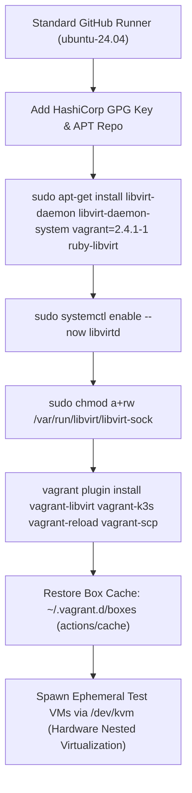

# K3s `e2e.yaml` Workflow Analysis: Virtualization Architecture, Execution Guide, and Cost Evaluation

## Executive Summary

| Evaluation Dimension | Upstream K3s (`k3s-io/k3s`) | Open-Source Fork (`sajuptpm/k3s`) | Private Enterprise Repository |
| :--- | :---: | :---: | :---: |
| **Actual Tool & Compute Cost** | **$0.00 / year** | **$0.00 / year** | **~$3,816 / year** (@ 100 runs/mo) |
| **Runner Type Used** | GitHub Standard `ubuntu-24.04` | GitHub Standard `ubuntu-24.04` | GitHub Standard or Self-Hosted |
| **Hypervisor Used** | Libvirt / QEMU via `/dev/kvm` | Libvirt / QEMU via `/dev/kvm` | Libvirt / QEMU via `/dev/kvm` |
| **External Cloud VMs Required?** | **No** | **No** | **No** (Optional contingency only) |
| **Vagrant / Libvirt Pre-installed?** | **No** (Installed on-the-fly) | **No** (Installed on-the-fly) | **No** (Installed on-the-fly) |

> [!IMPORTANT]
> **Will it cost $1,200/year to run `e2e.yaml`?**
> **No.** The pipeline runs **100% free ($0.00)** on public repositories.
> 
> The **$1,200/year ($100/month)** figure listed in the estimation spreadsheet is a **hypothetical external VM contingency reserve**. It reflects what an enterprise would pay if they chose to lease an external dedicated bare-metal cloud instance (e.g., AWS EC2 bare-metal or a $100/mo Hetzner server) in the event that nested virtualization was disallowed by corporate security or unavailable on their runners. In practice, upstream K3s **does not use external cloud VMs**; it relies entirely on GitHub-hosted runners using native hardware-assisted nested virtualization.

---

## 1. Where and How Vagrant and Libvirt are Installed in Upstream

### Is it on a GitHub Standard Runner?
**Yes.** Upstream runs the `e2e` jobs directly on standard, multi-tenant GitHub-hosted Linux runners.

### Exact Runner Labels in Upstream `e2e.yaml`
1. **`e2e` Job (Vagrant/Libvirt VMs):**
   ```yaml
   runs-on: ubuntu-24.04
   ```
   *(Historically pinned to `ubuntu-22.04`; both are standard 2-core, 7 GB RAM GitHub-hosted Linux runner VMs).*
2. **`docker-go` Job (Docker-in-Docker Container Clusters):**
   ```yaml
   runs-on: ${{ matrix.arch == 'arm64' && 'ubuntu-24.04-arm' || 'ubuntu-24.04' }}
   ```
3. **`docker-large` Job (Large Scale Cluster Testing):**
   ```yaml
   runs-on: cncf-ubuntu-32-128-x86
   if: github.repository_owner == 'k3s-io'
   ```
   *(This is a CNCF-sponsored self-hosted runner with 32 vCPUs and 128 GB RAM, restricted exclusively to the upstream organization).*

### How Vagrant & Libvirt Are Installed at Runtime
Vagrant and libvirt are **not included** in the standard GitHub Actions runner virtual environment image (`actions/runner-images`).

Instead, upstream installs and configures them **dynamically inside each runner VM during the first steps of the job** by calling the composite action [`.github/actions/vagrant-setup/action.yaml`](file:///c:/projects/k3s_new/k3s/.github/actions/vagrant-setup/action.yaml):

```yaml
- name: Set up vagrant and libvirt
  uses: ./.github/actions/vagrant-setup
```

#### Step-by-Step Installation Flow:


1. **HashiCorp APT Repository Configuration:**
   Downloads the official HashiCorp release key (`https://apt.releases.hashicorp.com/gpg`), verifies the fingerprint `D55C0D1AC78A8D8126CB631CFC9CA96ACA026560`, and adds `https://apt.releases.hashicorp.com` to `/etc/apt/sources.list.d/hashicorp.list`.
2. **Package Installation:**
   Installs `libvirt-daemon`, `libvirt-daemon-system`, `vagrant=2.4.1-1`, and `ruby-libvirt`, plus build dependencies (`libxslt-dev`, `libxml2-dev`, `libvirt-dev`, `ruby-bundler`, `ruby-dev`, `zlib1g-dev`).
3. **Daemon Activation & Permissions:**
   Enables and starts `libvirtd.service` via `systemctl`, and grants world read-write permissions to `/var/run/libvirt/libvirt-sock` to bypass runner user group restrictions.
4. **Vagrant Plugins:**
   Installs `vagrant-libvirt` (hypervisor driver), `vagrant-k3s` (provisioner), `vagrant-reload`, and `vagrant-scp`.
5. **Nested Virtualization Mechanism:**
   GitHub-hosted Linux virtual machines in Azure run with **Hardware-Assisted Nested Virtualization (Intel VT-x / AMD-V)** enabled by default. The `/dev/kvm` character device is exposed inside `ubuntu-24.04`, allowing QEMU and KVM to boot guest virtual machines at near-bare-metal speed without emulation slowdown.

---

## 2. How to Run `e2e.yaml`

### Method 1: In GitHub Actions (CI)

#### Triggers in Upstream:
- `push` to `main` and `release-*` branches (filtering out documentation and unrelated changes).
- `pull_request` touching core K3s code or tests.
- `workflow_dispatch` for manual on-demand execution.

#### Triggering via GitHub Web UI:
1. Navigate to your repository on GitHub.
2. Click the **Actions** tab.
3. In the left sidebar, select **E2E Test Coverage**.
4. Click **Run workflow**, choose your branch (e.g., `main`), and click **Run workflow**.

#### Triggering via GitHub CLI (`gh`):
```bash
gh workflow run e2e.yaml --ref main
```

#### Pipeline Execution Sequence:
1. **Compilation (`build` and `build-arm64`):**
   Calls [`.github/workflows/build-k3s.yaml`](file:///c:/projects/k3s_new/k3s/.github/workflows/build-k3s.yaml) to build the `k3s-amd64` and `k3s-arm64` binaries and package the test container images.
2. **Matrix E2E Execution (`e2e`):**
   Spawns parallel runners across 9 test suites:
   `etest: [startup, s3, embeddedmirror, privateregistry, wasm, externalip, rootless, multus, btrfs]`
   Each runner downloads the compiled binary, restores cached Vagrant boxes (`vagrant-box-ubuntu-2404` or `vagrant-box-leap`), and runs:
   ```bash
   ginkgo run -v -timeout=45m ./tests/e2e/${{ matrix.etest }}/ -- -ci -local
   ```
3. **Docker Topology Testing (`docker-go`):**
   Concurrently runs containerized cluster scenarios across 14 suites (`autoimport`, `dualstack`, `hardened`, `helm`, `ingress`, `metrics`, `network`, `nixsnapshotter`, `restart`, `secretsencryption`, `snapshotrestore`, `svcpoliciesandfirewall`, `token`, `upgrade`) on `ubuntu-24.04` (amd64) and `ubuntu-24.04-arm` (arm64).
4. **Coverage Reporting:**
   Uploads coverage profiles to Codecov via `codecov/codecov-action@v5`.

---

### Method 2: Running Locally on a Bare-Metal Server or Dev Machine

You can run the exact same E2E suite locally on any physical server (such as an Ubuntu host or Proxmox KVM VM) without GitHub Actions:

#### 1. Host System Requirements
- Linux OS (Ubuntu 22.04 or 24.04 recommended).
- Hardware virtualization enabled in BIOS (Intel VT-x or AMD-V).
- Verify KVM availability:
  ```bash
  kvm-ok
  # Expected output: INFO: /dev/kvm exists
  # KVM acceleration can be used
  ```

#### 2. Install Required Toolchain & Hypervisor
```bash
# Install QEMU, Libvirt, and compilation headers
sudo apt update
sudo apt install -y qemu-kvm libvirt-daemon-system libvirt-clients \
  ruby-libvirt vagrant ebtables dnsmasq-base libxslt-dev libxml2-dev \
  libvirt-dev zlib1g-dev ruby-dev libguestfs-tools

# Start and enable libvirt
sudo systemctl enable --now libvirtd
sudo usermod -aG libvirt $USER

# Install Vagrant plugins
vagrant plugin install vagrant-libvirt vagrant-scp vagrant-k3s vagrant-reload

# Install Ginkgo test runner
go install github.com/onsi/ginkgo/v2/ginkgo@latest
```

#### 3. Build K3s Binary
```bash
cd /path/to/k3s
make
# Generates the executable at ./dist/artifacts/k3s
```

#### 4. Run an E2E Test Suite
```bash
# Run a single E2E test (e.g. startup)
ginkgo run -v -timeout=45m ./tests/e2e/startup/ -- -ci -local

# Or run using standard Go test toolchain:
go test -v -timeout=45m ./tests/e2e/startup/... -run E2E
```

#### 5. Debugging Failed Local Runs
If a test fails, Vagrant leaves the guest VMs running for inspection:
```bash
cd tests/e2e/startup
vagrant status            # Check status of cluster nodes
vagrant ssh <node-name>   # SSH directly into a test VM
cat vagrant.log           # Inspect startup logs
vagrant destroy -f        # Tear down cluster when debugging is complete
```

---

## 3. Upstream Cost Analysis: What Upstream is Paying & Why

### Total Upstream Cost to Run `e2e.yaml`: **$0.00 / year**

| Pipeline Subsystem | Upstream Provider / Runner | Cost to Upstream | Operational Reason |
| :--- | :--- | :---: | :--- |
| **`e2e` Matrix (9 Suites)** | Standard GitHub-hosted `ubuntu-24.04` | **$0.00** | **GitHub Open-Source Policy:** Public open-source repositories receive unlimited free standard runner minutes. |
| **`docker-go` Matrix** | Standard `ubuntu-24.04` & `ubuntu-24.04-arm` | **$0.00** | Included in GitHub free public repository tier. |
| **`docker-large` Scale Job** | Self-hosted `cncf-ubuntu-32-128-x86` | **$0.00** | **CNCF Community Grant:** K3s is an official CNCF project. High-spec runners (32 cores, 128 GB RAM) are provided at zero cost via CNCF Community Infrastructure Lab / Equinix Metal grants. |
| **Virtualization License** | Libvirt & QEMU | **$0.00** | 100% open-source software (GPL/LGPL). |
| **Vagrant Software** | Vagrant by HashiCorp | **$0.00** | Free open-source BSL/MPL CLI tool. |
| **Vagrant Box Caching** | GitHub `actions/cache` | **$0.00** | GitHub includes up to 10 GB of free cache storage per repository. |
| **Coverage Reporting** | Codecov (`codecov/codecov-action`) | **$0.00** | Codecov SaaS provides free services to public open-source repositories. |

---

## 4. Cost Projection for a Private Enterprise Repository

If an organization runs `e2e.yaml` in a **private enterprise repository** where GitHub Actions minutes are billed:

### 1. Compute Runtime Breakdown (Single Pipeline Run)
- `build` + `build-arm64`: ~35 minutes
- `e2e` matrix (9 test suites @ ~25 minutes average): ~225 minutes
- `docker-go` matrix (~18 test suites @ ~15 minutes average): ~270 minutes
- **Total Runner Minutes per Full Run:** **~530 standard Linux minutes**

### 2. Commercial Cost Calculations
- Standard Linux 2-core runner rate: **$0.006 per minute**.
- **Cost per single run:** `530 minutes × $0.006 =` **~$3.18 USD**.
- **Monthly Spend:** 100 runs/month = **~$318.00 / month**.
- **Annual Spend:** **~$3,816.00 / year**.

### 3. Origin of the "$1,200/Year External VM Contingency"
- In certain enterprise environments (e.g., highly restricted AWS/Azure enterprise tenants or locked-down private runners), nested virtualization (`/dev/kvm`) may be disabled by security policy.
- The **$1,200/year ($100/month)** estimate was budgeted as an **external VM contingency allowance** to lease a dedicated bare-metal cloud instance (e.g., an AWS EC2 `c5.metal` instance or a dedicated server from Hetzner/OVH) to act as a self-hosted runner.
- **Conclusion:** Because standard GitHub-hosted `ubuntu-24.04` runners support nested virtualization out of the box, **the $1,200/year expense is completely avoidable** and is not spent by upstream or by forks running on public repositories.
