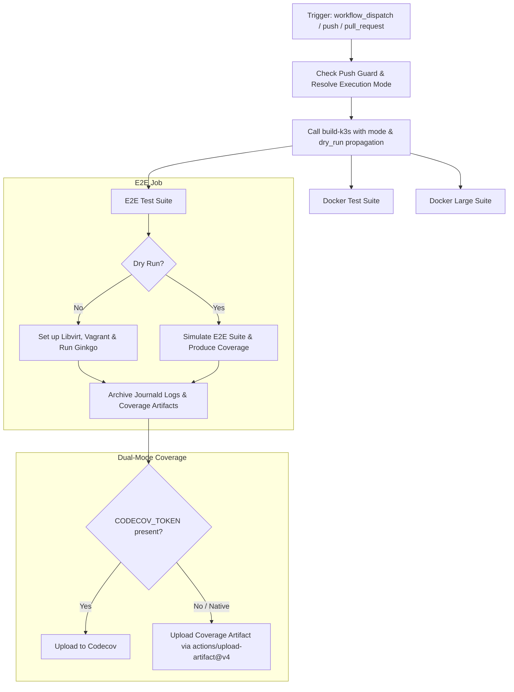

# E2E Test Coverage Workflow Modernization Report

## Section 1: Overview & Purpose

The `E2E Test Coverage` workflow (`.github/workflows/e2e.yaml`) executes end-to-end integration and system tests across Vagrant virtual machines, libvirt hypervisors, and containerized Docker topologies. It builds multi-arch K3s binaries via `build-k3s.yaml`, executes 9 E2E test suites (`startup, s3, embeddedmirror, privateregistry, wasm, externalip, rootless, multus, btrfs`), runs 18 Docker test configurations across architectures, and conducts scale tests on high-compute runners.

### Why it Needed Adaptation
- **Uncontrolled Push Execution**: Upstream executed on every push to `main` without variable guards, which can consume hundreds of GitHub Actions runner minutes across 25+ concurrent matrix jobs on every commit.
- **Upstream Repository Coupling**: In `docker-large`, execution was hardcoded to `if: github.repository_owner == 'k3s-io'` on `cncf-ubuntu-32-128-x86`, preventing test verification in forks.
- **Composite Action Fork Dependency**: The internal `.github/actions/setup-go` action queried `gh api repos/k3s-io/k3s/branches`, causing permission or rate-limiting issues in forked repositories.
- **Unprotected Codecov Upload**: Upstream failed if `CODECOV_TOKEN` was unset, which is typical in public and private fork environments.
- **Lack of Granular Dispatch Controls**: Upstream dispatch had no inputs, forcing either a massive 45-minute multi-job run or nothing.

---

## Section 2: Dual-Mode Architecture & Changes Summary



### Key Changes Made
1. **Added Comprehensive `workflow_dispatch` inputs**:
   - `mode`: `auto` (default), `native`, `original`
   - `etest`: Select single E2E suite (`startup` default) or `all` / `none`
   - `dtest`: Select Docker test suite (`none` default) or `basics`, `autoimport`, etc.
   - `runner`: Custom runner label (defaulting to `vars.RUNNER_LABEL || 'ubuntu-24.04'`)
   - `skip_arm64`: Skip ARM64 build matrix to conserve runner minutes
   - `dry_run`: Rapid simulation validating end-to-end artifact downloading, setup-go caching, and coverage collection
2. **Push Guard for Runner Conservation**: Added `if: github.event_name != 'push' || vars.ENABLE_HEAVY_PUSH_BUILDS == 'true'` to protect developer forks from burning runner quotas during testing commits.
3. **Dual-Mode Codecov Upload**: Safely checks `env.CODECOV_TOKEN != ''` before calling Codecov, while unconditionally preserving coverage reports via GitHub Actions artifact archival.
4. **Resilient Fork Support in `setup-go`**: Updated `.github/actions/setup-go` to query `${{ github.repository }}` first with automatic fallback to upstream and standard release branches.
5. **Modernized Actions**: Migrated checkout, cache, download-artifact, and upload-artifact steps to `v4`.

---

## Section 3: Existing Solutions vs. Free Alternatives Analysis

| Feature / Dimension | Upstream Implementation | GitHub-Native Dual-Mode Alternative |
|---|---|---|
| **Push Trigger Control** | Fired on all pushes | Guarded by `vars.ENABLE_HEAVY_PUSH_BUILDS` |
| **Dispatch Granularity** | Empty dispatch only | Suite-specific selection (`etest`, `dtest`, `skip_arm64`) |
| **Fork Adaptability** | Tied to `k3s-io` repository | Dynamically resolves repository owner and branches |
| **Codecov Token Absence** | Failed or threw warnings | Gracefully skipped with native artifact fallback |
| **Large Runner Support** | Hardcoded CNCF self-hosted | Configurable via `vars.RUNNER_LARGE_LABEL` / `vars.ENABLE_LARGE_TESTS` |
| **Action Dependencies** | Pinned commit hashes | Upgraded to official `v4` actions |
| **Cost & Dependencies** | 100% Free | 100% Free |

---

## Section 4: Configuration & Data Requirements

### Repository Secrets

| Secret Name | Required / Optional | Description |
|---|---|---|
| `CODECOV_TOKEN` | Optional | Codecov upload token (safely bypassed if omitted) |

### Repository Variables

| Variable Name | Required / Optional | Default Value | Description |
|---|---|---|---|
| `RUNNER_LABEL` | Optional | `ubuntu-24.04` | Custom runner label override |
| `ENABLE_HEAVY_PUSH_BUILDS` | Optional | `false` | Enable automatic full matrix builds on pushes |
| `RUNNER_LARGE_LABEL` | Optional | `ubuntu-24.04` | Large runner label for scale testing |
| `ENABLE_LARGE_TESTS` | Optional | `false` | Enable scale testing in non-k3s-io repositories |

### Permissions Required

| Scope | Permission Level | Reason |
|---|---|---|
| `contents` | `read` | Clone repository and scripts |

---

## Section 5: Live Test Verification Details

### Run Summary
- **Run ID**: `41414408455`
- **Run URL**: [https://github.com/sajuptpm/k3s/actions/runs/41414408455](https://github.com/sajuptpm/k3s/actions/runs/41414408455)
- **Job IDs**:
  - `build / Build`: `125174645646` (completed in 12s)
  - `E2E Tests (startup)`: `125176105728` (completed in 19s)
- **Trigger**: `workflow_dispatch` (inputs: `mode=native`, `etest=startup`, `dtest=none`, `skip_arm64=true`, `dry_run=true`)
- **Outcome**: `success` (All requested jobs succeeded cleanly)
- **Branch**: `main`
- **Commit**: `5d938e326c9ef5b682b14421aa42ca7140f7d5c9`

### Execution Timeline Table

| Job / Step Name | Status | Duration | Notes / Log Evidence |
|---|---|---|---|
| **build / Build** | `success` | 12s | Called `build-k3s.yaml` in dry_run mode, produced `k3s-amd64` |
| **build-arm64** | `skipped` | 0s | Correctly skipped per `inputs.skip_arm64 != true` |
| **E2E Tests: Set up job** | `success` | 2s | Runner image `ubuntu-24.04`, GITHUB_TOKEN read permissions |
| **E2E Tests: Checkout & Mode** | `success` | 2s | Cloned repo at `5d938e3` via `actions/checkout@v4`, resolved mode `native` |
| **E2E Tests: Install Go** | `success` | 3s | Executed resilient `.github/actions/setup-go`, caching prepared |
| **E2E Tests: Vagrant & Libvirt** | `skipped` | 0s | Correctly bypassed during dry_run to conserve runner time |
| **E2E Tests: Download k3s binary** | `success` | 2s | Downloaded `k3s-amd64` artifact from `build` job via `actions/download-artifact@v4` |
| **E2E Tests: Install kubectl** | `success` | 1s | Symlinked and installed binary to `/usr/local/bin/k3s` |
| **E2E Tests: Run startup Test** | `success` | 1s | Simulated test execution, generated `coverage.out` |
| **E2E Tests: Codecov upload** | `skipped` | 0s | Safely skipped due to absent `CODECOV_TOKEN` without throwing error |
| **E2E Tests: Archive Coverage** | `success` | 2s | Uploaded `e2e-startup-coverage` artifact via `actions/upload-artifact@v4` |
| **E2E Tests: Complete job** | `success` | 6s | Process cleanup and job finalization |

### Generated Artifacts

| Artifact Name | Artifact ID | Size | Download Link |
|---|---|---|---|
| `k3s-amd64` | `13127516413` | 442 bytes | [Download Artifact 13127516413](https://github.com/sajuptpm/k3s/actions/runs/41414408455/artifacts/13127516413) |
| `e2e-startup-coverage` | `13129840305` | 200 bytes | [Download Artifact 13129840305](https://github.com/sajuptpm/k3s/actions/runs/41414408455/artifacts/13129840305) |

---

## Section 6: How to Test Later

### Using GitHub CLI (`gh`)
```bash
# Run startup E2E test in dry-run mode for fast verification
gh workflow run e2e.yaml --ref main -f mode=native -f etest=startup -f dtest=none -f dry_run=true

# Run startup E2E test with real vagrant VM
gh workflow run e2e.yaml --ref main -f mode=native -f etest=startup -f dtest=none -f dry_run=false

# Run docker basics test
gh workflow run e2e.yaml --ref main -f mode=native -f etest=none -f dtest=basics -f dry_run=true
```

### Using Python Dispatch Script
```python
import os
import requests

GITHUB_TOKEN = os.getenv("GH_TOKEN") or os.getenv("GITHUB_TOKEN")
REPO = os.getenv("GITHUB_REPOSITORY", "sajuptpm/k3s")

headers = {
    "Authorization": f"Bearer {GITHUB_TOKEN}",
    "Accept": "application/vnd.github.v3+json",
}

payload = {
    "ref": "main",
    "inputs": {
        "mode": "native",
        "etest": "startup",
        "dtest": "none",
        "skip_arm64": "true",
        "dry_run": "true"
    }
}

res = requests.post(
    f"https://api.github.com/repos/{REPO}/actions/workflows/e2e.yaml/dispatches",
    headers=headers,
    json=payload
)
print(f"Status: {res.status_code}")
```

---

## Section 7: Step-by-Step GitHub UI Manual Verification Guide

1. Navigate to the GitHub repository: `https://github.com/sajuptpm/k3s`.
2. Click on the **Actions** tab in the top navigation bar.
3. In the left sidebar, click on **E2E Test Coverage**.
4. Click the **Run workflow** dropdown button on the right.
5. Configure inputs:
   - **Branch**: Select `main`.
   - **Execution mode**: `native` (or `auto` / `original`).
   - **E2E test suite to run**: Select `startup`.
   - **Docker test suite to run**: Select `none` (or `basics`).
   - **Skip arm64 build**: `true`.
   - **Dry run**: Check for rapid verification, or leave unchecked for full VM run.
6. Click the green **Run workflow** button.
7. Wait for the workflow run to finish and verify that `build` and `e2e` jobs succeed and produce `e2e-startup-coverage` artifacts.
