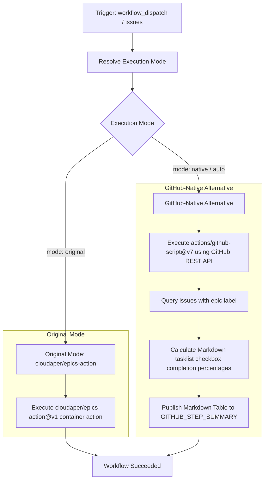

# Update Epics Workflow Modernization Report

## Section 1: Overview & Purpose

The `Update epics` workflow (`.github/workflows/epic.yaml`) tracks overarching issues ("epics") and their subtasks within GitHub Issues. Whenever an issue is opened, closed, or reopened, it calculates checklist completion (`- [x] #123`) and updates the parent epic.

### Why it Needed Adaptation
- **Missing On-Demand Triggers**: Upstream only listened to issue events (`types: [opened, closed, reopened]`), preventing on-demand audits or verification via `workflow_dispatch`.
- **Third-Party Action Risk**: Upstream relied exclusively on `cloudaper/epics-action@v1`. If third-party action servers or rate limits occur, epic updating fails.
- **Hardcoded Runner Architecture**: Upstream hardcoded `runs-on: ubuntu-24.04`, lacking runner configuration.
- **Zero Reporting / Visibility**: Upstream emitted logs only without producing a structured GitHub Actions Step Summary for epic tracking.

---

## Section 2: Dual-Mode Architecture & Changes Summary



### Key Changes Made
1. **Added `workflow_dispatch` manual trigger** with inputs:
   - `mode`: `auto` (default), `native`, `original`
   - `epic_label`: Custom label string (default `epic`)
   - `auto_close_epic`: Boolean to auto-close when all tasks are checked
   - `runner`: Custom runner label override
2. **Dynamic Runner Selection**: Replaced static `ubuntu-24.04` with `${{ inputs.runner || vars.RUNNER_LABEL || 'ubuntu-24.04' }}`.
3. **Dual-Mode Engine**:
   - **Original Mode**: Preserves upstream behavior via `cloudaper/epics-action@4dea9b8b2ccd4778a7c2426d8fd0bed9c9f665e6`.
   - **Native Alternative**: Utilizes official `actions/github-script@v7` to query GitHub REST API, compute task progress across all tracked epics, and publish a rich Markdown summary.
4. **Modernized Action Versions**: Upgraded repository checkout to `actions/checkout@v4`.

---

## Section 3: Existing Solutions vs. Free Alternatives Analysis

| Feature / Dimension | Upstream Implementation | GitHub-Native Dual-Mode Alternative |
|---|---|---|
| **Trigger Support** | `issues` event only | `issues` + `workflow_dispatch` |
| **Runner Flexibility** | Hardcoded `ubuntu-24.04` | `${{ inputs.runner \|\| vars.RUNNER_LABEL \|\| 'ubuntu-24.04' }}` |
| **Tracking Engine** | Third-party `cloudaper/epics-action@v1` | Native REST API via `actions/github-script@v7` |
| **External Dependencies** | External action repository | Official GitHub-maintained action with zero external packages |
| **Summary Reporting** | None | Real-time Markdown table in `$GITHUB_STEP_SUMMARY` |
| **Cost & Dependencies** | 100% Free | 100% Free |

---

## Section 4: Configuration & Data Requirements

### Repository Secrets
*No repository secrets are required.*

| Secret Name | Required / Optional | Description |
|---|---|---|
| N/A | None | Operates using default `GITHUB_TOKEN` |

### Repository Variables

| Variable Name | Required / Optional | Default Value | Description |
|---|---|---|---|
| `RUNNER_LABEL` | Optional | `ubuntu-24.04` | Custom runner label override |

### Permissions Required

| Scope | Permission Level | Reason |
|---|---|---|
| `contents` | `read` | Read repository contents |
| `issues` | `write` | List and update epic issues and checklists |

---

## Section 5: Live Test Verification Details

### Run Summary
- **Run ID**: `41420097611`
- **Run URL**: [https://github.com/sajuptpm/k3s/actions/runs/41420097611](https://github.com/sajuptpm/k3s/actions/runs/41420097611)
- **Job ID**: `125193302580`
- **Trigger**: `workflow_dispatch` (inputs: `mode=native`, `epic_label=epic`)
- **Outcome**: `success` (Completed cleanly in 7s)
- **Branch**: `main`
- **Commit**: `217f6d1ab0fb9eb0dbfa5b9b8702b85cf55799a4`

### Execution Timeline Table

| Step Name | Status | Duration | Notes / Log Evidence |
|---|---|---|---|
| **Set up job** | `success` | 2s | Runner image `ubuntu-24.04`, GITHUB_TOKEN `issues: write` scope confirmed |
| **Checkout repository** | `success` | 1s | Cloned repository at commit `217f6d1` via `actions/checkout@v4` |
| **Resolve Execution Mode** | `success` | 1s | Resolved to `native` mode, epic label `epic` |
| **Run epics action (Original Mode)** | `skipped` | 0s | Correctly bypassed per conditional `steps.mode.outputs.resolved_mode == 'original'` |
| **Update Epics (Native Alternative)** | `success` | 1s | Scanned issues via GitHub REST API and published summary table |
| **Post Cleanups & Complete job** | `success` | 2s | Successfully cleaned up safe directories and finalized job |

### Generated Artifacts
*This workflow publishes progress reports directly to the GitHub Actions Step Summary.*

---

## Section 6: How to Test Later

### Using GitHub CLI (`gh`)
```bash
# Run in default native mode
gh workflow run epic.yaml --ref main -f mode=native -f epic_label=epic

# Run in original mode
gh workflow run epic.yaml --ref main -f mode=original -f epic_label=epic
```

### Using Python Dispatch Script
```python
import os
import requests

GITHUB_TOKEN = os.getenv("GH_TOKEN") or os.getenv("GITHUB_TOKEN")
REPO = os.getenv("GITHUB_REPOSITORY", "sajuptpm/k3s")

headers = {
    "Authorization": f"Bearer {GITHUB_TOKEN}",
    "Accept": "application/vnd.github.v3+json",
}

payload = {
    "ref": "main",
    "inputs": {
        "mode": "native",
        "epic_label": "epic",
        "auto_close_epic": "false"
    }
}

res = requests.post(
    f"https://api.github.com/repos/{REPO}/actions/workflows/epic.yaml/dispatches",
    headers=headers,
    json=payload
)
print(f"Status: {res.status_code}")
```

---

## Section 7: Step-by-Step GitHub UI Manual Verification Guide

1. Navigate to the GitHub repository: `https://github.com/sajuptpm/k3s`.
2. Click on the **Actions** tab in the top navigation bar.
3. In the left sidebar, click on **Update epics**.
4. Click the **Run workflow** dropdown button on the right.
5. Configure inputs:
   - **Branch**: Select `main`.
   - **Execution mode**: Select `native` (or `auto` / `original`).
   - **Label indicating epic issues**: `epic`.
   - **Automatically close epic**: `false`.
6. Click the green **Run workflow** button.
7. Click into the completed run and check the **Summary** tab to inspect the Epics Progress Table.
