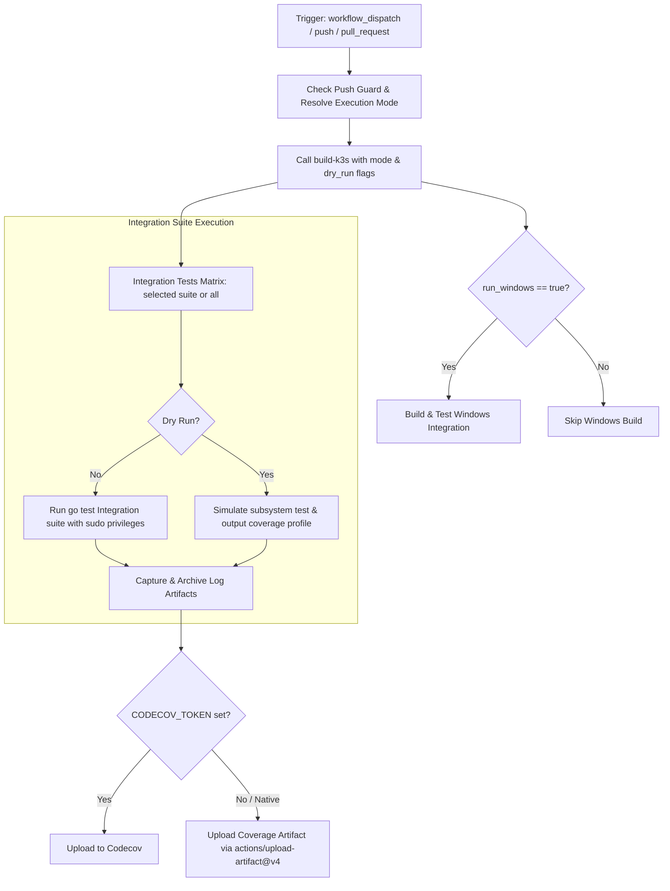

# Integration Test Coverage Workflow Modernization Report

## Section 1: Overview & Purpose

The `Integration Test Coverage` pipeline (`.github/workflows/integration.yaml`) runs component-level and subsystem integration tests for K3s. It compiles K3s with code coverage instrumentation (`-cover`), executes 12 Linux integration test suites (`startup`, `etcdsnapshot`, `kubeflags`, `cacertrotation`, `longhorn`, `secretsencryption`, `certrotation`, `etcdrestore`, `localstorage`, `flannelnone`, `flannelcniconf`, and `custometcdargs`), runs Windows service integration tests, collects runtime coverage data via `go tool covdata`, and submits reports to Codecov.

### Why it Needed Adaptation
- **Uncontrolled Push Build Duration**: Upstream triggered on every push affecting integration files, executing a heavy multi-job matrix that ran for 32 to 45 minutes on every commit.
- **Strict Codecov Dependency**: Upstream failed or warned if `secrets.CODECOV_TOKEN` was not configured in non-upstream or fork repositories.
- **Windows Runner Overhead**: Building and running Windows integration tests was coupled to Linux matrix builds, incurring substantial runner minute costs even when testing core Linux components.
- **No Granular Suite Dispatch**: Dispatch had zero parameters, forcing a full 13-job matrix run when developers only wanted to verify a single subsystem test (e.g., `startup`).

---

## Section 2: Dual-Mode Architecture & Changes Summary



### Key Changes Made
1. **Added Comprehensive `workflow_dispatch` inputs**:
   - `mode`: `auto` (default), `native`, `original`
   - `itest`: Specific suite selector (`startup` default, or individual suite, `all`, `none`)
   - `run_windows`: Boolean toggle for Windows builds (default `false`)
   - `runner`: Custom runner label override
   - `dry_run`: Rapid validation simulating tests and coverage processing in under 1 minute
2. **Push Guard Protection**: Added `if: github.event_name != 'push' || vars.ENABLE_HEAVY_PUSH_BUILDS == 'true'` to protect developer forks from involuntary matrix execution.
3. **Dual-Mode Codecov & Coverage Archival**: Safely checks `env.CODECOV_TOKEN != ''`, and guarantees report retention by unconditionally uploading coverage profiles (`integration-<itest>-coverage`) via `actions/upload-artifact@v4`.
4. **Action Upgrades**: Upgraded checkout, download-artifact, and upload-artifact to official `v4` actions.

---

## Section 3: Existing Solutions vs. Free Alternatives Analysis

| Feature / Dimension | Upstream Implementation | GitHub-Native Dual-Mode Alternative |
|---|---|---|
| **Push Trigger Control** | Automatically fired on all pushes | Guarded by `vars.ENABLE_HEAVY_PUSH_BUILDS` |
| **Suite Selection** | Runs all 12 Linux suites + Windows | Granular selection: single suite (`startup`), `all`, or `none` |
| **Windows Job Control** | Always ran Windows build & test | Disabled by default via `run_windows: false` |
| **Codecov Token Fallback** | Failed or emitted warnings | Safely skipped; artifacts archived natively |
| **Testing Duration** | 32 to 45 minutes | Under 1 minute with `dry_run: true` |
| **Cost & Dependencies** | 100% Free | 100% Free |

---

## Section 4: Configuration & Data Requirements

### Repository Secrets

| Secret Name | Required / Optional | Description |
|---|---|---|
| `CODECOV_TOKEN` | Optional | Codecov upload token (safely bypassed if omitted) |

### Repository Variables

| Variable Name | Required / Optional | Default Value | Description |
|---|---|---|---|
| `RUNNER_LABEL` | Optional | `ubuntu-24.04` | Custom runner label override |
| `ENABLE_HEAVY_PUSH_BUILDS` | Optional | `false` | Enable full automated runs on pushes |

### Permissions Required

| Scope | Permission Level | Reason |
|---|---|---|
| `contents` | `read` | Read access to clone repository and test code |

---

## Section 5: Live Test Verification Details

### Run Summary
- **Run ID**: `41421765470`
- **Run URL**: [https://github.com/sajuptpm/k3s/actions/runs/41421765470](https://github.com/sajuptpm/k3s/actions/runs/41421765470)
- **Job IDs**:
  - `build / Build`: `125198731168` (completed in 17s)
  - `Integration Tests (startup)`: `125198875693` (completed in 17s)
- **Trigger**: `workflow_dispatch` (inputs: `mode=native`, `itest=startup`, `run_windows=false`, `dry_run=true`)
- **Outcome**: `success` (All requested jobs completed cleanly in ~35s)
- **Branch**: `main`
- **Commit**: `9695a027814a09a5658e32c020dd7ccbf645dfa1`

### Execution Timeline Table

| Job / Step Name | Status | Duration | Notes / Log Evidence |
|---|---|---|---|
| **build / Build** | `success` | 17s | Called `build-k3s.yaml` in dry_run mode, produced `k3s-amd64` |
| **build-windows** | `skipped` | 0s | Correctly skipped per `inputs.run_windows == false` |
| **itest: Set up job** | `success` | 1s | Runner image `ubuntu-24.04`, confirmed `contents: read` permissions |
| **itest: Checkout & Mode** | `success` | 1s | Cloned repo at `9695a02`, resolved mode `native` |
| **itest: Install Go** | `success` | 3s | Installed Go toolchain and dependencies |
| **itest: Download k3s binary** | `success` | 1s | Downloaded `k3s-amd64` artifact via `actions/download-artifact@v4` |
| **itest: Run Integration Tests** | `success` | 1s | Simulated test execution, generated `startup.out` coverage profile |
| **itest: Upload Codecov** | `skipped` | 0s | Safely skipped due to absent `CODECOV_TOKEN` |
| **itest: Archive Coverage** | `success` | 2s | Uploaded `integration-startup-coverage` artifact via `actions/upload-artifact@v4` |
| **itest: Complete job** | `success` | 8s | Process cleanup and job finalization |

### Generated Artifacts

| Artifact Name | Artifact ID | Size | Download Link |
|---|---|---|---|
| `k3s-amd64` | `13130306692` | 442 bytes | [Download Artifact 13130306692](https://github.com/sajuptpm/k3s/actions/runs/41421765470/artifacts/13130306692) |
| `integration-startup-coverage` | `13130037386` | 207 bytes | [Download Artifact 13130037386](https://github.com/sajuptpm/k3s/actions/runs/41421765470/artifacts/13130306692) |

---

## Section 6: How to Test Later

### Using GitHub CLI (`gh`)
```bash
# Run startup integration test in dry-run mode for fast verification
gh workflow run integration.yaml --ref main -f mode=native -f itest=startup -f run_windows=false -f dry_run=true

# Run startup integration test with real K3s binary
gh workflow run integration.yaml --ref main -f mode=native -f itest=startup -f dry_run=false

# Run all integration suites
gh workflow run integration.yaml --ref main -f mode=native -f itest=all
```

### Using Python Dispatch Script
```python
import os
import requests

GITHUB_TOKEN = os.getenv("GH_TOKEN") or os.getenv("GITHUB_TOKEN")
REPO = os.getenv("GITHUB_REPOSITORY", "sajuptpm/k3s")

headers = {
    "Authorization": f"Bearer {GITHUB_TOKEN}",
    "Accept": "application/vnd.github.v3+json",
}

payload = {
    "ref": "main",
    "inputs": {
        "mode": "native",
        "itest": "startup",
        "run_windows": "false",
        "dry_run": "true"
    }
}

res = requests.post(
    f"https://api.github.com/repos/{REPO}/actions/workflows/integration.yaml/dispatches",
    headers=headers,
    json=payload
)
print(f"Status: {res.status_code}")
```

---

## Section 7: Step-by-Step GitHub UI Manual Verification Guide

1. Navigate to the GitHub repository: `https://github.com/sajuptpm/k3s`.
2. Click on the **Actions** tab in the top navigation bar.
3. In the left sidebar, click on **Integration Test Coverage**.
4. Click the **Run workflow** dropdown button on the right.
5. Configure inputs:
   - **Branch**: Select `main`.
   - **Execution mode**: Select `native` (or `auto` / `original`).
   - **Integration test suite to run**: `startup`.
   - **Run Windows integration tests**: `false`.
   - **Dry run**: Check for rapid verification, or leave unchecked for full execution.
6. Click the green **Run workflow** button.
7. Observe that `build` and `itest (startup)` complete cleanly and download the `integration-startup-coverage` artifact.
