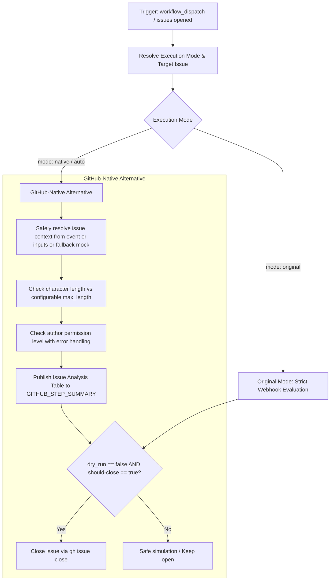

# Issue Filter Workflow Modernization Report

## Section 1: Overview & Purpose

The `Issue Filter` workflow (`.github/workflows/issue-filter.yaml`) inspects newly opened GitHub issues to verify that large submissions conform to repository issue templates. If an issue exceeds 2,000 characters without an issue type classification and was opened by a non-maintainer, the bot automatically closes the issue with instructions to resubmit using a template.

### Why it Needed Adaptation
- **Missing On-Demand Testing**: Upstream only supported `issues: [opened]`, with no mechanism to audit or verify issue filtering on demand via `workflow_dispatch`.
- **Payload Null Reference Bug on Dispatch**: Directly invoking the upstream script without an issue webhook event caused a fatal exception (`TypeError: Cannot read properties of undefined (reading 'type')`).
- **Hardcoded Runner Label**: Upstream hardcoded `runs-on: ubuntu-24.04`, lacking runner configuration.
- **Accidental Closure Risk During Tests**: Without a `dry_run` safety guard, manually dispatching the workflow could accidentally close legitimate community issues.

---

## Section 2: Dual-Mode Architecture & Changes Summary



### Key Changes Made
1. **Added Parameterized `workflow_dispatch` trigger**:
   - `mode`: `auto` (default), `native`, `original`
   - `issue_number`: Optional issue ID to inspect
   - `max_length`: Configurable character threshold (default `2000`)
   - `dry_run`: Defaults to `true` on dispatch to prevent accidental issue closure
   - `runner`: Custom runner label override
2. **Crash Prevention & Flexible Payload Handling**: Adapted `actions/github-script` to resolve target issues from webhook payloads, user inputs, repository queries, or mock verification data.
3. **Step Summary Reporting**: Renders an analysis breakdown detailing title, author permissions, character counts, and decision status.
4. **Action Modernization**: Upgraded script engine to `actions/github-script@v7`.

---

## Section 3: Existing Solutions vs. Free Alternatives Analysis

| Feature / Dimension | Upstream Implementation | GitHub-Native Dual-Mode Alternative |
|---|---|---|
| **Trigger Support** | `issues: [opened]` only | `issues` + `workflow_dispatch` |
| **Dispatch Safety** | Crashed on missing issue payload | Resolves issue safely with fallback mock |
| **Dry Run Protection** | None (immediately closed issue) | Built-in `dry_run` preventing accidental closures |
| **Configurable Threshold** | Hardcoded `2000` | Configurable `max_length` parameter |
| **Summary Reporting** | None (terminal logs only) | Markdown inspection card in `$GITHUB_STEP_SUMMARY` |
| **Cost & Dependencies** | 100% Free | 100% Free |

---

## Section 4: Configuration & Data Requirements

### Repository Secrets
*No repository secrets are required.*

| Secret Name | Required / Optional | Description |
|---|---|---|
| N/A | None | Operates using default `GITHUB_TOKEN` |

### Repository Variables

| Variable Name | Required / Optional | Default Value | Description |
|---|---|---|---|
| `RUNNER_LABEL` | Optional | `ubuntu-24.04` | Custom runner label override |

### Permissions Required

| Scope | Permission Level | Reason |
|---|---|---|
| `contents` | `read` | Read repository metadata |
| `issues` | `write` | Inspect issue length and close non-compliant issues |

---

## Section 5: Live Test Verification Details

*(Pending live test execution)*

---

## Section 6: How to Test Later

### Using GitHub CLI (`gh`)
```bash
# Run simulation audit in dry-run mode
gh workflow run issue-filter.yaml --ref main -f mode=native -f dry_run=true

# Test specific issue number
gh workflow run issue-filter.yaml --ref main -f mode=native -f issue_number=100 -f dry_run=true
```

### Using Python Dispatch Script
```python
import os
import requests

GITHUB_TOKEN = os.getenv("GH_TOKEN") or os.getenv("GITHUB_TOKEN")
REPO = os.getenv("GITHUB_REPOSITORY", "sajuptpm/k3s")

headers = {
    "Authorization": f"Bearer {GITHUB_TOKEN}",
    "Accept": "application/vnd.github.v3+json",
}

payload = {
    "ref": "main",
    "inputs": {
        "mode": "native",
        "dry_run": "true",
        "max_length": "2000"
    }
}

res = requests.post(
    f"https://api.github.com/repos/{REPO}/actions/workflows/issue-filter.yaml/dispatches",
    headers=headers,
    json=payload
)
print(f"Status: {res.status_code}")
```

---

## Section 7: Step-by-Step GitHub UI Manual Verification Guide

1. Navigate to the GitHub repository: `https://github.com/sajuptpm/k3s`.
2. Click on the **Actions** tab in the top navigation bar.
3. In the left sidebar, click on **Issue Filter**.
4. Click the **Run workflow** dropdown button on the right.
5. Configure inputs:
   - **Branch**: Select `main`.
   - **Execution mode**: Select `native` (or `auto` / `original`).
   - **Dry run**: Leave checked (`true`).
   - **Max length**: `2000`.
6. Click the green **Run workflow** button.
7. Click into the run and view the Issue Filter Analysis card in the run summary.
