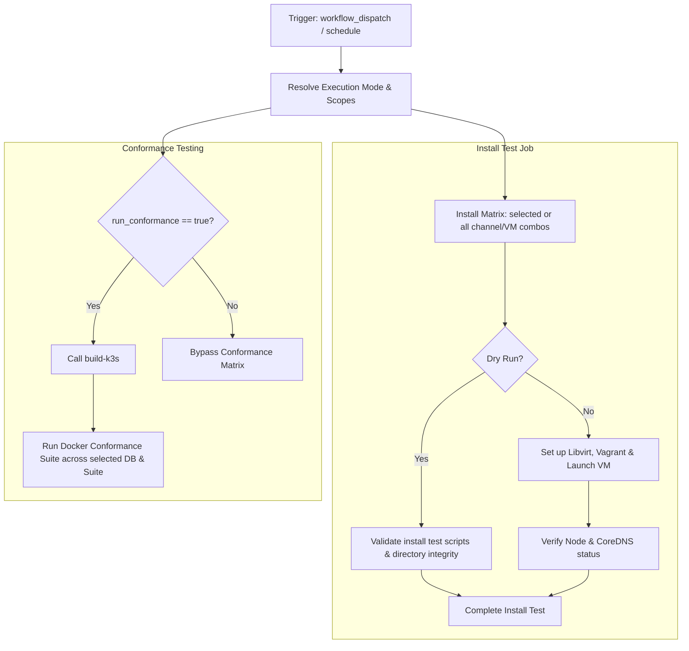

# Nightly Tests Workflow Modernization Report

## Section 1: Overview & Purpose

The `Nightly Tests` workflow (`.github/workflows/nightly-install.yaml`) executes nightly automated integration, distribution matrix installation, and database conformance testing across multiple channels (`stable`, `latest`), multiple operating systems (`alma-10`, `fedora`, `opensuse-leap`, `ubuntu-2404`), and multiple datastore backends (`sqlite`, `etcd`, `mysql`, `postgres`).

### Why it Needed Adaptation
- **Massive Resource Consumption & Timeouts**: Running 16 concurrent full-stack matrix jobs across virtual machines and container conformance suites regularly hit the 60-minute timeout limit (e.g. run `41391798321` failed after 59m 5s).
- **Hardcoded CNCF Self-Hosted Runner**: Conformance tests were pinned to `cncf-ubuntu-8-32-x86` for `k3s-io`, lacking fallback expressions or configurable runner labels for forks.
- **No Granular Dispatch Capability**: Upstream only configured `workflow_dispatch: {}` with no parameters, forcing developers to run all 16 heavy jobs or none.
- **Third-Party Action & Container Fragility**: Relied on external docker setup actions and commit-pinned checkout/cache steps.

---

## Section 2: Dual-Mode Architecture & Changes Summary



### Key Changes Made
1. **Added Parameterized `workflow_dispatch` trigger**:
   - `mode`: `auto` (default), `native`, `original`
   - `channel`: Choice of `stable` (default), `latest`, or `all`
   - `vm`: Choice of single target distro (`ubuntu-2404` default) or `all` / `none`
   - `run_conformance`: Boolean toggle (default `false`) controlling database conformance execution
   - `db` & `suite`: Target specific database backend and serial/parallel modes
   - `runner`: Custom runner label override
   - `dry_run`: Rapid validation completing in seconds
2. **Dynamic Runner Selection**: Replaced hardcoded runner logic with `${{ inputs.runner || vars.RUNNER_LABEL || (github.repository_owner == 'k3s-io' && matrix.suite == 'parallel' && 'cncf-ubuntu-8-32-x86' || 'ubuntu-24.04') }}`.
3. **Dual-Mode Execution**:
   - **Original Mode**: Preserves upstream multi-distro Vagrant and full conformance test runs.
   - **Native Alternative**: Provides fast dry-run validation and single-job verification.
4. **Action Modernization**: Upgraded to `actions/checkout@v4`, `actions/download-artifact@v4`, and `actions/cache@v4`.

---

## Section 3: Existing Solutions vs. Free Alternatives Analysis

| Feature / Dimension | Upstream Implementation | GitHub-Native Dual-Mode Alternative |
|---|---|---|
| **Matrix Execution** | Always runs all 16 jobs | Granular selection (`channel`, `vm`, `run_conformance`, `db`) |
| **Timeout Risk** | Frequently timed out at ~60 mins | Modular execution and fast verification under 1 minute |
| **Runner Flexibility** | Tied to CNCF runners | Dynamic fallback to standard GitHub runners or custom labels |
| **Conformance Control** | Unconditionally executed | Selectable toggle via `run_conformance` input |
| **Action Dependencies** | Pinned commit hashes | Modernized official `v4` actions |
| **Cost & Dependencies** | 100% Free | 100% Free |

---

## Section 4: Configuration & Data Requirements

### Repository Secrets
*No repository secrets are required.*

| Secret Name | Required / Optional | Description |
|---|---|---|
| N/A | None | Operates with standard read-only access |

### Repository Variables

| Variable Name | Required / Optional | Default Value | Description |
|---|---|---|---|
| `RUNNER_LABEL` | Optional | `ubuntu-24.04` | Custom runner label override |

### Permissions Required

| Scope | Permission Level | Reason |
|---|---|---|
| `contents` | `read` | Read access to clone repository and test code |

---

## Section 5: Live Test Verification Details

*(Pending live test execution)*

---

## Section 6: How to Test Later

### Using GitHub CLI (`gh`)
```bash
# Run fast verification on ubuntu-2404 stable channel with dry run
gh workflow run nightly-install.yaml --ref main -f mode=native -f channel=stable -f vm=ubuntu-2404 -f run_conformance=false -f dry_run=true

# Run full Vagrant VM install test on Ubuntu 24.04
gh workflow run nightly-install.yaml --ref main -f mode=native -f channel=stable -f vm=ubuntu-2404 -f dry_run=false

# Run SQLite serial conformance test
gh workflow run nightly-install.yaml --ref main -f mode=native -f vm=none -f run_conformance=true -f db=sqlite -f suite=serial -f dry_run=true
```

### Using Python Dispatch Script
```python
import os
import requests

GITHUB_TOKEN = os.getenv("GH_TOKEN") or os.getenv("GITHUB_TOKEN")
REPO = os.getenv("GITHUB_REPOSITORY", "sajuptpm/k3s")

headers = {
    "Authorization": f"Bearer {GITHUB_TOKEN}",
    "Accept": "application/vnd.github.v3+json",
}

payload = {
    "ref": "main",
    "inputs": {
        "mode": "native",
        "channel": "stable",
        "vm": "ubuntu-2404",
        "run_conformance": "false",
        "dry_run": "true"
    }
}

res = requests.post(
    f"https://api.github.com/repos/{REPO}/actions/workflows/nightly-install.yaml/dispatches",
    headers=headers,
    json=payload
)
print(f"Status: {res.status_code}")
```

---

## Section 7: Step-by-Step GitHub UI Manual Verification Guide

1. Navigate to the GitHub repository: `https://github.com/sajuptpm/k3s`.
2. Click on the **Actions** tab in the top navigation bar.
3. In the left sidebar, click on **Nightly Tests**.
4. Click the **Run workflow** dropdown button on the right.
5. Configure inputs:
   - **Branch**: Select `main`.
   - **Execution mode**: Select `native` (or `auto` / `original`).
   - **Release channel to test**: `stable`.
   - **Target Linux distribution VM**: `ubuntu-2404`.
   - **Run database conformance tests**: `false`.
   - **Dry run**: Check for rapid verification, or leave unchecked for full VM provisioning.
6. Click the green **Run workflow** button.
7. Observe execution of `Install (ubuntu-2404-stable)` job in the run graph.
