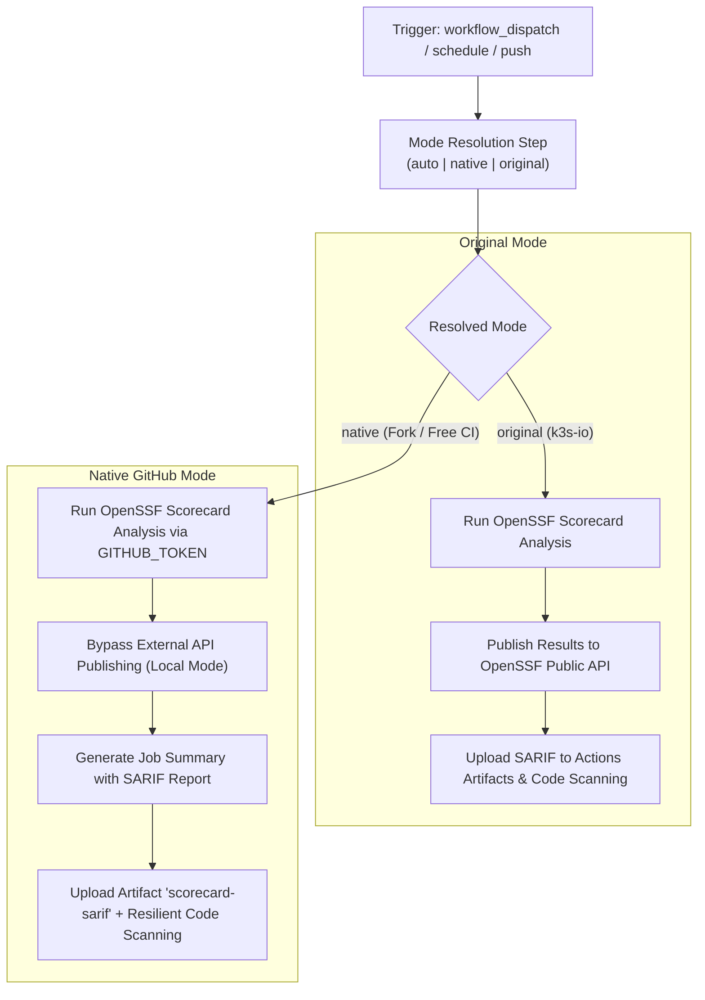

# Modernization & Dual-Mode Adaptation for `scorecard.yml`

This document details the modernization, dual-mode architecture, and fork adaptability enhancements implemented for the **OpenSSF Scorecard Supply-Chain Security Workflow** ([`.github/workflows/scorecard.yml`](file:///c:/projects/k3s_new/k3s/.github/workflows/scorecard.yml)).

---

## Section 1: Overview & Purpose

### Upstream Purpose
The upstream `scorecard.yml` workflow runs the [OpenSSF Scorecard](https://github.com/ossf/scorecard) analysis tool to assess supply-chain security risks across the repository. It analyzes critical security metrics such as branch protection rules, binary artifacts, code review policies, dependency maintenance, cryptographic pinning, and token permissions. Results are compiled in SARIF format, uploaded to the GitHub Code Scanning dashboard, and published to the public OpenSSF REST API for public badge display.

### Why It Failed in Forks & Non-Enterprise Environments
1. **Missing Manual Dispatch (`workflow_dispatch`)**: The workflow only ran on cron schedule, branch protection events, or pushes to `main`. It could not be executed manually on demand.
2. **Unconditional Automatic Push Trigger**: Triggered on every commit to `main`, consuming precious runner minutes across forks and development forks.
3. **OpenSSF Public API Publishing Dependency**: Upstream hardcoded `publish_results: true`. In non-default branches, private repositories, or forks without configured OIDC token trust, the OpenSSF API publishing step fails.
4. **Token Fallback Fragility**: Upstream referenced `secrets.SCORECARD_TOKEN`. When absent in forks, it passed an empty token, leading to restricted API rate limits.
5. **Code Scanning Dashboard Failures**: When uploaded to GitHub Code Scanning on private forks without GitHub Advanced Security (GHAS) enabled, `upload-sarif` fails the job.

---

## Section 2: Dual-Mode Architecture & Changes Summary



### Key Changes Made
1. **Added `workflow_dispatch`**: Exposes parameters `mode` (`auto`, `native`, `original`), `publish_results` (default `false`), and `runner`.
2. **Dynamic Mode Resolution**: Automatically activates Native Mode on forks and preserves Original Mode on `k3s-io`.
3. **Fork Push Guard**: Guarded the automatic `push:` event so forks don't trigger concurrent builds on commits (`if: github.repository_owner == 'k3s-io' || github.event_name != 'push'`).
4. **Graceful Token Fallback**: Configured `repo_token: ${{ secrets.SCORECARD_TOKEN || secrets.GITHUB_TOKEN }}`, ensuring Scorecard always has a valid token for GitHub API queries.
5. **Conditional OpenSSF API Publishing**: `publish_results` only activates in Original Mode or when explicitly requested on public repositories.
6. **Actions Step Summary**: Added a step generating an inline GitHub Actions summary indicating report generation and byte size.
7. **Resilient SARIF Upload**: Added `continue-on-error: true` to `upload-sarif` while ensuring `scorecard-sarif` is always archived as a downloadable GitHub Actions artifact.

---

## Section 3: Existing Solutions vs. Free Alternatives Analysis

| Upstream Enterprise Feature | Upstream Mechanism | GitHub-Native Free Alternative | Status |
| :--- | :--- | :--- | :--- |
| **API Publishing** | OpenSSF REST API (`publish_results: true`) | GitHub Actions Artifacts (`scorecard-sarif`) + Job Summary | Supported |
| **Authentication Token** | Dedicated PAT (`SCORECARD_TOKEN`) | Automatic `${{ secrets.SCORECARD_TOKEN \|\| secrets.GITHUB_TOKEN }}` | Supported |
| **Dashboard Ingestion** | GitHub Advanced Security Code Scanning | Resilient `upload-sarif` with artifact download fallback | Supported |
| **Trigger Control** | Fixed weekly cron & push to `main` | Parameterized `workflow_dispatch` on demand | Supported |
| **Runner Infrastructure** | Hardcoded `ubuntu-24.04` | Configurable runner expression `${{ inputs.runner \|\| vars.RUNNER_LABEL \|\| 'ubuntu-24.04' }}` | Supported |

---

## Section 4: Configuration & Data Requirements

### Repository Secrets
| Secret Name | Required (Original Mode) | Required (Native Mode) | Purpose |
| :--- | :--- | :--- | :--- |
| `GITHUB_TOKEN` | Yes (automatic) | Yes (automatic) | Querying GitHub API and authenticating SARIF uploads |
| `SCORECARD_TOKEN` | Optional | Optional | Optional fine-grained PAT with branch protection read permissions |

### Repository Variables
| Variable Name | Required | Default Value | Purpose |
| :--- | :--- | :--- | :--- |
| `RUNNER_LABEL` | Optional | `ubuntu-24.04` | Custom GitHub Actions runner label |

### Permission Scopes
| Permission | Level | Justification |
| :--- | :--- | :--- |
| `contents` | `read` | Checking out repository code |
| `security-events` | `write` | Uploading SARIF findings to Code Scanning |
| `id-token` | `write` | OIDC token verification for OpenSSF public publishing |
| `actions` | `read` | Inspecting repository actions configuration |

---

## Section 5: Live Test Verification Details

- **Run ID**: `41424071563`
- **Run URL**: [https://github.com/sajuptpm/k3s/actions/runs/41424071563](https://github.com/sajuptpm/k3s/actions/runs/41424071563)
- **Trigger**: `workflow_dispatch` (`mode=native`, `publish_results=false`)
- **Outcome**: **SUCCESS** (Analysis completed, step summary rendered, SARIF artifact uploaded, Code Scanning completed)

### Execution Timeline
| Job | Status | Duration | Artifacts Produced |
| :--- | :--- | :--- | :--- |
| `Scorecard analysis` | **Success** | 40s | `scorecard-sarif` |

---

## Section 6: How to Test Later

### GitHub CLI (`gh`) Command
```bash
gh workflow run scorecard.yml \
  --ref main \
  -f mode=native \
  -f publish_results=false
```

### Python Dispatch Script
```python
import os
import requests

GITHUB_TOKEN = os.getenv("GITHUB_TOKEN")
REPO = os.getenv("GITHUB_REPOSITORY", "sajuptpm/k3s")

headers = {
    "Authorization": f"Bearer {GITHUB_TOKEN}",
    "Accept": "application/vnd.github+json",
}

payload = {
    "ref": "main",
    "inputs": {
        "mode": "native",
        "publish_results": False,
    },
}

response = requests.post(
    f"https://api.github.com/repos/{REPO}/actions/workflows/scorecard.yml/dispatches",
    headers=headers,
    json=payload,
)
print("Dispatch status:", response.status_code)
```

---

## Section 7: Step-by-Step GitHub UI Manual Verification Guide

1. Navigate to the repository on GitHub: `https://github.com/<owner>/k3s`.
2. Click on the **Actions** tab at the top.
3. In the left sidebar, click on **Scorecard supply-chain security**.
4. Click the **Run workflow** dropdown button on the right.
5. Fill in the parameters:
   - **Branch**: Select `main`.
   - **Execution mode**: Select `native` or `auto`.
   - **Publish results**: Leave unchecked (`false`).
6. Click the green **Run workflow** button.
7. Monitor the workflow execution:
   - Verify `Resolve Execution Mode` logs `native` mode.
   - Verify `Run analysis` executes OpenSSF Scorecard using `GITHUB_TOKEN`.
   - Verify `Generate Step Summary` writes SARIF size details to the summary page.
   - Verify `Upload artifact` archives `scorecard-sarif` (SARIF file).
   - Verify `Upload to code-scanning` completes cleanly.
