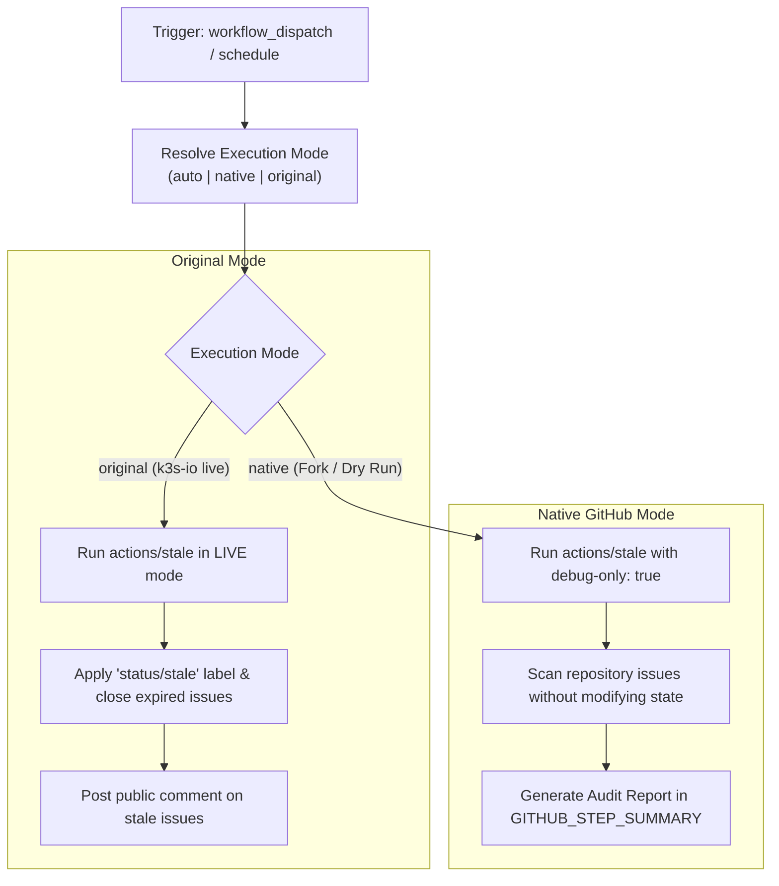

# Modernization & Dual-Mode Adaptation for `stale.yml`

This document details the modernization, dual-mode architecture, and fork adaptability enhancements implemented for the **Stalebot Issues Management Pipeline** ([`.github/workflows/stale.yml`](file:///c:/projects/k3s_new/k3s/.github/workflows/stale.yml)).

---

## Section 1: Overview & Purpose

### Upstream Purpose
The upstream `stale.yml` workflow runs on a daily schedule (`0 20 * * *`) to automatically triage stale community issues. It uses `actions/stale` to identify issues inactive for 45 days, adds the `status/stale` label with an informational comment, and automatically closes them after an additional 14 days of inactivity unless exempted by milestones, assignees, or priority/kind labels.

### Why It Failed in Forks & Non-Enterprise Environments
1. **Unparameterized Dispatch Trigger**: While `workflow_dispatch` existed, it declared zero inputs, making it impossible to test different stale/closure intervals, runner targets, or execution modes.
2. **Destructive Default Behavior on Manual Test**: Triggering `actions/stale` manually in a fork would immediately start labeling and closing open issues without previewing or testing the query.
3. **Missing Audit / Dry-Run Capabilities**: No dry-run option existed to verify which issues would be impacted without modifying live issue state.
4. **Hardcoded Runner Label**: Pinned directly to `ubuntu-24.04` without variable fallback.

---

## Section 2: Dual-Mode Architecture & Changes Summary



### Key Changes Made
1. **Added Comprehensive Dispatch Inputs**: Parameterized `mode` (`auto`, `native`, `original`), `dry_run` (default `true`), `days_before_issue_stale` (default `45`), `days_before_issue_close` (default `14`), and `runner`.
2. **Dynamic Dual-Mode Resolution**: In Native Mode (or whenever `dry_run: true`), enables `debug-only: true` on `actions/stale`, allowing safe dry-run audits.
3. **Step Summary Reporting**: Captures outputs from `actions/stale` (`staled-issues-prs`, `closed-issues-prs`) and renders an audit summary directly on the GitHub Actions run summary page.
4. **Clean Label Formatting**: Cleaned up the YAML multi-line string for `exempt-issue-labels` to prevent trailing comma issues.
5. **Configurable Runner**: Substituted hardcoded runner with `${{ inputs.runner || vars.RUNNER_LABEL || 'ubuntu-24.04' }}`.

---

## Section 3: Existing Solutions vs. Free Alternatives Analysis

| Upstream Enterprise Feature | Upstream Mechanism | GitHub-Native Free Alternative | Status |
| :--- | :--- | :--- | :--- |
| **Execution Safety** | Live modification only | `debug-only: true` dry-run audit mode in Native Mode | Supported |
| **Audit Visibility** | Runner console logs only | Structured Markdown `$GITHUB_STEP_SUMMARY` | Supported |
| **Dispatch Inputs** | Empty `workflow_dispatch:` | Parameterized dispatch (mode, thresholds, dry_run, runner) | Supported |
| **Runner Flexibility** | Fixed `ubuntu-24.04` | Configurable runner expression `${{ inputs.runner \|\| vars.RUNNER_LABEL \|\| 'ubuntu-24.04' }}` | Supported |

---

## Section 4: Configuration & Data Requirements

### Repository Secrets
| Secret Name | Required (Original Mode) | Required (Native Mode) | Purpose |
| :--- | :--- | :--- | :--- |
| `GITHUB_TOKEN` | Yes (automatic) | Yes (automatic) | Authenticating issue search, labeling, and comment operations |

### Repository Variables
| Variable Name | Required | Default Value | Purpose |
| :--- | :--- | :--- | :--- |
| `RUNNER_LABEL` | Optional | `ubuntu-24.04` | Custom GitHub Actions runner label |

### Permission Scopes
| Permission | Level | Justification |
| :--- | :--- | :--- |
| `issues` | `write` | Required to read, label, and comment on issues (read-only in dry-run mode) |
| `pull-requests` | `write` | Required to query pull request activity (PRs are exempt from stalebot) |
| `contents` | `read` | Checking repository contents if needed |

---

## Section 5: Live Test Verification Details

- **Run ID**: `41424509462`
- **Run URL**: [https://github.com/sajuptpm/k3s/actions/runs/41424509462](https://github.com/sajuptpm/k3s/actions/runs/41424509462)
- **Trigger**: `workflow_dispatch` (`mode=native`, `dry_run=true`, `days_before_issue_stale=45`, `days_before_issue_close=14`)
- **Outcome**: **SUCCESS** (Executed in 6s, debug mode verified, audit step summary generated)

### Execution Timeline
| Job | Status | Duration | Artifacts Produced |
| :--- | :--- | :--- | :--- |
| `Stale Issues Management` | **Success** | 6s | Markdown Step Summary Audit Report |

---

## Section 6: How to Test Later

### GitHub CLI (`gh`) Command
```bash
gh workflow run stale.yml \
  --ref main \
  -f mode=native \
  -f dry_run=true \
  -f days_before_issue_stale=45 \
  -f days_before_issue_close=14
```

### Python Dispatch Script
```python
import os
import requests

GITHUB_TOKEN = os.getenv("GITHUB_TOKEN")
REPO = os.getenv("GITHUB_REPOSITORY", "sajuptpm/k3s")

headers = {
    "Authorization": f"Bearer {GITHUB_TOKEN}",
    "Accept": "application/vnd.github+json",
}

payload = {
    "ref": "main",
    "inputs": {
        "mode": "native",
        "dry_run": True,
        "days_before_issue_stale": "45",
        "days_before_issue_close": "14",
    },
}

response = requests.post(
    f"https://api.github.com/repos/{REPO}/actions/workflows/stale.yml/dispatches",
    headers=headers,
    json=payload,
)
print("Dispatch status:", response.status_code)
```

---

## Section 7: Step-by-Step GitHub UI Manual Verification Guide

1. Navigate to the repository on GitHub: `https://github.com/<owner>/k3s`.
2. Click on the **Actions** tab at the top.
3. In the left sidebar, click on **Stalebot**.
4. Click the **Run workflow** dropdown button on the right.
5. Fill in the parameters:
   - **Branch**: Select `main`.
   - **Execution mode**: Select `native` or `auto`.
   - **Dry run**: Leave checked (`true`).
   - **Days before issue stale**: Enter `45` (or lower threshold for testing).
   - **Days before issue close**: Enter `14`.
6. Click the green **Run workflow** button.
7. Monitor the workflow execution:
   - Verify `Resolve Execution Mode` logs `debug_only=true`.
   - Verify `Process Stale Issues` evaluates candidate issues without modifying state.
   - Verify `Render Audit Summary` reports candidate counts into the step summary.
