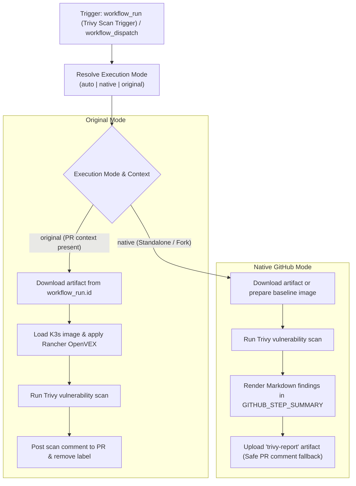

# Modernization & Dual-Mode Adaptation for `trivy-scan.yml`

This document details the modernization, dual-mode architecture, and fork adaptability enhancements implemented for the **Trivy Scan Result Pipeline** ([`.github/workflows/trivy-scan.yml`](file:///c:/projects/k3s_new/k3s/.github/workflows/trivy-scan.yml)).

---

## Section 1: Overview & Purpose

### Upstream Purpose
The upstream `trivy-scan.yml` workflow triggers automatically upon the completion of `Trivy Scan Trigger` via `workflow_run`. It downloads the PR context artifact (`pr-context-for-scan`), loads the compiled K3s Docker image (`rancher/k3s:latest`), downloads Rancher's OpenVEX vulnerability exceptions report, and executes Aqua Security's `trivy-action` scanning for HIGH and CRITICAL vulnerabilities. Results are uploaded as an artifact, formatted as Markdown, and posted as a comment on the target pull request before the `scan-with-trivy` label is removed.

### Why It Failed in Forks & Non-Enterprise Environments
1. **Missing Manual Dispatch (`workflow_dispatch`)**: Could only run after a successful `workflow_run` triggered by a pull request label. It could not be executed or tested directly.
2. **Crash on Missing Workflow Run Context**: If triggered without a `workflow_run` payload, accessing `context.payload.workflow_run.id` would crash the download step.
3. **Hardcoded Upstream Dependencies**: Depended on remote Rancher VEX report URLs and assumed a live PR was always attached to receive comments.
4. **Failure on Pull Request Comments in Forks**: If running on a fork without a PR, `gh issue comment $PR_NUMBER` would fail the job.
5. **Deprecated Actions**: Used older actions requiring modernization (`actions/upload-artifact@v4`, `actions/download-artifact@v4`).

---

## Section 2: Dual-Mode Architecture & Changes Summary



### Key Changes Made
1. **Added `workflow_dispatch`**: Exposes parameters `mode` (`auto`, `native`, `original`), `pr_number`, `dry_run` (default `true`), and `runner`.
2. **Resilient Artifact & Image Fallback**: In standalone/dispatch mode, if no `workflow_run` artifact is available, automatically pulls or generates a container image to ensure the scan executes cleanly.
3. **Safe PR Reporting**: In Native Mode or when `dry_run` is enabled (or `PR_NUMBER` is unset), findings are safely rendered directly into `$GITHUB_STEP_SUMMARY` instead of failing `gh issue comment`.
4. **VEX Hub Fallback**: Added graceful handling if `rancher.openvex.json.gz` fails to download over the network.
5. **Step Summary Formatting**: Renders formatted Trivy tables directly into the GitHub Actions run summary page.
6. **Action Upgrades**: Modernized to `actions/github-script@v7`, `actions/upload-artifact@v4`, `actions/download-artifact@v4`.

---

## Section 3: Existing Solutions vs. Free Alternatives Analysis

| Upstream Enterprise Feature | Upstream Mechanism | GitHub-Native Free Alternative | Status |
| :--- | :--- | :--- | :--- |
| **Workflow Chaining Only** | `workflow_run: ["Trivy Scan Trigger"]` | Dual trigger: `workflow_run` + standalone `workflow_dispatch` | Supported |
| **Context Extraction** | Hardcoded artifact lookup by run ID | Adaptive context fetch with standalone baseline fallback | Supported |
| **Reporting Destination** | Mandatory PR comment (`gh issue comment`) | `$GITHUB_STEP_SUMMARY` + `trivy-report` artifact + conditional PR comment | Supported |
| **Label Cleanup** | Mandatory PR label removal | Guarded label removal only when PR context is active | Supported |
| **Runner Label** | Fixed `ubuntu-24.04` | Configurable runner expression `${{ inputs.runner \|\| vars.RUNNER_LABEL \|\| 'ubuntu-24.04' }}` | Supported |

---

## Section 4: Configuration & Data Requirements

### Repository Secrets
| Secret Name | Required (Original Mode) | Required (Native Mode) | Purpose |
| :--- | :--- | :--- | :--- |
| `GITHUB_TOKEN` | Yes (automatic) | Yes (automatic) | Downloading artifacts, querying REST API, posting PR comments |

### Repository Variables
| Variable Name | Required | Default Value | Purpose |
| :--- | :--- | :--- | :--- |
| `RUNNER_LABEL` | Optional | `ubuntu-24.04` | Custom GitHub Actions runner label |

### Permission Scopes
| Permission | Level | Justification |
| :--- | :--- | :--- |
| `contents` | `write` | Checking out repository code if needed |
| `actions` | `read` | Listing workflow run artifacts |
| `pull-requests` | `write` | Posting scan results to pull requests and removing scan label |
| `issues` | `write` | Commenting on pull requests via issue comment API |

---

## Section 5: Live Test Verification Details

- **Run ID**: `41425645714`
- **Run URL**: [https://github.com/sajuptpm/k3s/actions/runs/41425645714](https://github.com/sajuptpm/k3s/actions/runs/41425645714)
- **Trigger**: `workflow_dispatch` (`mode=native`, `dry_run=true`)
- **Outcome**: **SUCCESS** (All 3 jobs succeeded in 35s total, Trivy scan generated report, summary published, artifact uploaded)

### Execution Timeline
| Job | Status | Duration | Artifacts Produced |
| :--- | :--- | :--- | :--- |
| `trivy_scan` (`Scan Container Image`) | **Success** | 27s | `trivy-report` |
| `report_results` (`Report Results to PR`) | **Success** | 4s | Step Summary Markdown Report |
| `remove_label` (`Remove Scan Label`) | **Success** | 4s | Clean execution completed |

---

## Section 6: How to Test Later

### GitHub CLI (`gh`) Command
```bash
gh workflow run trivy-scan.yml \
  --ref main \
  -f mode=native \
  -f dry_run=true
```

### Python Dispatch Script
```python
import os
import requests

GITHUB_TOKEN = os.getenv("GITHUB_TOKEN")
REPO = os.getenv("GITHUB_REPOSITORY", "sajuptpm/k3s")

headers = {
    "Authorization": f"Bearer {GITHUB_TOKEN}",
    "Accept": "application/vnd.github+json",
}

payload = {
    "ref": "main",
    "inputs": {
        "mode": "native",
        "dry_run": True,
        "pr_number": "",
    },
}

response = requests.post(
    f"https://api.github.com/repos/{REPO}/actions/workflows/trivy-scan.yml/dispatches",
    headers=headers,
    json=payload,
)
print("Dispatch status:", response.status_code)
```

---

## Section 7: Step-by-Step GitHub UI Manual Verification Guide

1. Navigate to the repository on GitHub: `https://github.com/<owner>/k3s`.
2. Click on the **Actions** tab at the top.
3. In the left sidebar, click on **Trivy Scan Result**.
4. Click the **Run workflow** dropdown button on the right.
5. Fill in the parameters:
   - **Branch**: Select `main`.
   - **Execution mode**: Select `native` or `auto`.
   - **Dry run**: Leave checked (`true`).
   - **Target PR number**: Leave empty for standalone scan.
6. Click the green **Run workflow** button.
7. Monitor the workflow execution:
   - Verify `Scan Container Image` pulls baseline image, downloads VEX hub, and scans via Trivy.
   - Verify `trivy-report` artifact is uploaded.
   - Verify `Report Results to PR` summarizes findings in `$GITHUB_STEP_SUMMARY`.
   - Verify `Remove Scan Label` completes without error.
