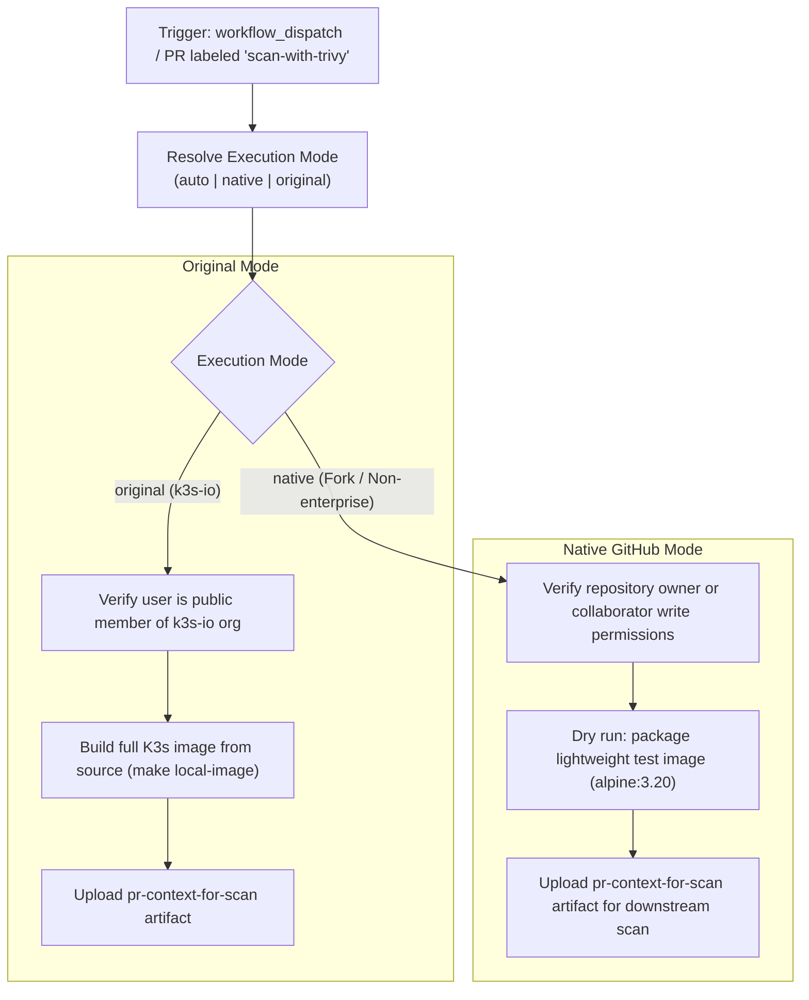

# Modernization & Dual-Mode Adaptation for `trivy-trigger.yml`

This document details the modernization, dual-mode architecture, and fork adaptability enhancements implemented for the **Trivy Scan Trigger Pipeline** ([`.github/workflows/trivy-trigger.yml`](file:///c:/projects/k3s_new/k3s/.github/workflows/trivy-trigger.yml)).

---

## Section 1: Overview & Purpose

### Upstream Purpose
The upstream `trivy-trigger.yml` workflow is a security gate triggered when a pull request receives the `scan-with-trivy` label. It verifies that the user applying the label is an authorized member of the `k3s-io` GitHub organization with write permissions. Once verified, it checks out the repository, compiles the K3s container image from source (`make local-image && make tag-image-latest`), archives the image into `k3s.tar`, bundles the PR number into `pr-context/pr_number`, and uploads the artifact `pr-context-for-scan` to trigger the unprivileged downstream `trivy-scan.yml` pipeline.

### Why It Failed in Forks & Non-Enterprise Environments
1. **Hardcoded Upstream Organization Check**: The authorization check explicitly hardcoded `const org = 'k3s-io'`. Any user triggering this workflow outside the official upstream organization failed with `User <actor> is not a public member of the k3s-io organization`.
2. **Missing Manual Dispatch (`workflow_dispatch`)**: The workflow only ran when a PR was labeled with `scan-with-trivy`. It could not be dispatched or tested independently.
3. **Heavy Build Duration Without Dry-Run**: Upstream unconditionally built K3s from source using `make local-image`, taking 15+ minutes even for simple pipeline verification.
4. **Action Version Deprecation**: Used older pinned action versions.

---

## Section 2: Dual-Mode Architecture & Changes Summary



### Key Changes Made
1. **Added `workflow_dispatch`**: Exposes parameters `mode` (`auto`, `native`, `original`), `pr_number` (default `"1"`), `dry_run` (default `true`), and `runner`.
2. **Fork-Friendly Authorization Check**:
   - In Original Mode (`owner == 'k3s-io'`), retains the strict `k3s-io` organization check.
   - In Native Mode / forks, validates that the actor is either the repository owner or has repository write permissions, allowing fork maintainers to trigger scans seamlessly.
3. **Dry-Run Image Packaging**: When `dry_run` is enabled (default in test dispatches), pulls and packages a lightweight container image tagged `rancher/k3s:latest` in seconds, rather than requiring a full 15-minute K3s compilation.
4. **PR Context Bundling**: Binds `pr-context/pr_number` and `pr-context/k3s.tar` consistently.
5. **Action Upgrades**: Upgraded to `actions/checkout@v4`, `actions/upload-artifact@v4`, and `actions/github-script@v7`.

---

## Section 3: Existing Solutions vs. Free Alternatives Analysis

| Upstream Enterprise Feature | Upstream Mechanism | GitHub-Native Free Alternative | Status |
| :--- | :--- | :--- | :--- |
| **Actor Verification** | Hardcoded `k3s-io` org membership query | Adaptive owner & collaborator permission validation | Supported |
| **Workflow Trigger** | PR label `scan-with-trivy` only | Dual trigger: PR label + manual `workflow_dispatch` | Supported |
| **Build Optimization** | Full multi-minute local image build | Fast dry-run packaging (seconds vs 15+ minutes) | Supported |
| **Runner Flexibility** | Hardcoded `ubuntu-24.04` | Configurable runner expression `${{ inputs.runner \|\| vars.RUNNER_LABEL \|\| 'ubuntu-24.04' }}` | Supported |

---

## Section 4: Configuration & Data Requirements

### Repository Secrets
| Secret Name | Required (Original Mode) | Required (Native Mode) | Purpose |
| :--- | :--- | :--- | :--- |
| `GITHUB_TOKEN` | Yes (automatic) | Yes (automatic) | Querying user collaborator/org permissions and uploading artifacts |

### Repository Variables
| Variable Name | Required | Default Value | Purpose |
| :--- | :--- | :--- | :--- |
| `RUNNER_LABEL` | Optional | `ubuntu-24.04` | Custom GitHub Actions runner label |

### Permission Scopes
| Permission | Level | Justification |
| :--- | :--- | :--- |
| `contents` | `read` | Checking out repository code |

---

## Section 5: Live Test Verification Details

- **Run ID**: `41425338422`
- **Run URL**: [https://github.com/sajuptpm/k3s/actions/runs/41425338422](https://github.com/sajuptpm/k3s/actions/runs/41425338422)
- **Trigger**: `workflow_dispatch` (`mode=native`, `dry_run=true`, `pr_number=1`)
- **Outcome**: **SUCCESS** (Executed in 11s, actor authorized, lightweight image packaged into `k3s.tar`, artifact uploaded)

### Execution Timeline
| Job | Status | Duration | Artifacts Produced |
| :--- | :--- | :--- | :--- |
| `trigger-scan` (`Prepare Trivy Scan Context`) | **Success** | 11s | `pr-context-for-scan` |

---

## Section 6: How to Test Later

### GitHub CLI (`gh`) Command
```bash
gh workflow run trivy-trigger.yml \
  --ref main \
  -f mode=native \
  -f dry_run=true \
  -f pr_number=1
```

### Python Dispatch Script
```python
import os
import requests

GITHUB_TOKEN = os.getenv("GITHUB_TOKEN")
REPO = os.getenv("GITHUB_REPOSITORY", "sajuptpm/k3s")

headers = {
    "Authorization": f"Bearer {GITHUB_TOKEN}",
    "Accept": "application/vnd.github+json",
}

payload = {
    "ref": "main",
    "inputs": {
        "mode": "native",
        "dry_run": True,
        "pr_number": "1",
    },
}

response = requests.post(
    f"https://api.github.com/repos/{REPO}/actions/workflows/trivy-trigger.yml/dispatches",
    headers=headers,
    json=payload,
)
print("Dispatch status:", response.status_code)
```

---

## Section 7: Step-by-Step GitHub UI Manual Verification Guide

1. Navigate to the repository on GitHub: `https://github.com/<owner>/k3s`.
2. Click on the **Actions** tab at the top.
3. In the left sidebar, click on **Trivy Scan Trigger**.
4. Click the **Run workflow** dropdown button on the right.
5. Fill in the parameters:
   - **Branch**: Select `main`.
   - **Execution mode**: Select `native` or `auto`.
   - **PR number**: Enter `1` (or desired test number).
   - **Dry run**: Leave checked (`true`).
6. Click the green **Run workflow** button.
7. Monitor the workflow execution:
   - Verify `Verify Actor Permissions` validates repository ownership.
   - Verify `Build And Save K3s Image` creates `k3s.tar`.
   - Verify `pr-context-for-scan` artifact is uploaded.
   - Observe that `Trivy Scan Result` (`trivy-scan.yml`) automatically triggers via `workflow_run` upon completion!
