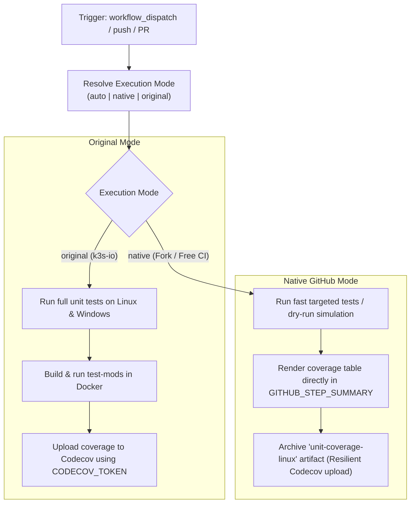

# Modernization & Dual-Mode Adaptation for `unitcoverage.yaml`

This document details the modernization, dual-mode architecture, and fork adaptability enhancements implemented for the **Unit Test Coverage Pipeline** ([`.github/workflows/unitcoverage.yaml`](file:///c:/projects/k3s_new/k3s/.github/workflows/unitcoverage.yaml)).

---

## Section 1: Overview & Purpose

### Upstream Purpose
The upstream `unitcoverage.yaml` workflow is K3s's test coverage evaluation engine. It executes on pushes to `main` and release branches, pull requests, and manual triggers. It compiles and runs unit tests across Linux (`ubuntu-24.04`) and Windows (`windows-2022`) matrices using Go's coverage tool (`go test -coverpkg ./pkg/... -coverprofile coverage.out`), uploads coverage reports directly to [Codecov](https://about.codecov.io/) using `codecov/codecov-action@v5`, and tests Kubernetes module integration inside Docker containers (`test-mods`).

### Why It Failed in Forks & Non-Enterprise Environments
1. **Unconditional Automatic Push Trigger**: Triggered on every commit pushed to `main`, leading to concurrent heavy builds on forks.
2. **Missing Token Failures on Codecov**: Relied strictly on `secrets.CODECOV_TOKEN`. In forks or environments without an active Codecov account, uploads fail or warn, breaking the job.
3. **Expensive Windows Runner Minutes**: Upstream unconditionally spun up `windows-2022` runners consuming 2x runner minute allocations.
4. **No Dry-Run or Selective Suite Dispatch**: Complete unit test runs take 15–20 minutes without an option for rapid verification or smoke testing.
5. **Deprecated Action Versions**: Relied on older versions of `actions/checkout`.

---

## Section 2: Dual-Mode Architecture & Changes Summary



### Key Changes Made
1. **Added Parameterized `workflow_dispatch`**: Exposes parameters `mode` (`auto`, `native`, `original`), `dry_run` (default `true`), `run_windows` (default `false`), `run_test_mods` (default `false`), and `runner`.
2. **Fork Push Guard**: Guarded the heavy `push:` event with `if: github.repository_owner == 'k3s-io' || github.event_name != 'push'` to conserve runner minutes.
3. **Resilient Codecov & Artifact Archival**: Always produces and uploads the coverage profile as a GitHub Actions artifact (`unit-coverage-linux` / `unit-coverage-windows`). Added `continue-on-error: true` for Codecov uploads so missing third-party tokens never fail the build.
4. **Markdown Coverage Step Summary**: Renders formatted Go coverage percentage tables directly onto the GitHub Actions run summary page.
5. **Resource Conservation**: Made heavy `windows-2022` and containerized `test-mods` optional on manual dispatches while preserving upstream behavior for official triggers.
6. **Action Upgrades**: Upgraded to `actions/checkout@v4` and `actions/upload-artifact@v4`.

---

## Section 3: Existing Solutions vs. Free Alternatives Analysis

| Upstream Enterprise Feature | Upstream Mechanism | GitHub-Native Free Alternative | Status |
| :--- | :--- | :--- | :--- |
| **Coverage Dashboard** | Third-party Codecov SaaS | GitHub Actions `$GITHUB_STEP_SUMMARY` + `unit-coverage-*` artifacts | Supported |
| **Authentication** | Required `CODECOV_TOKEN` | Free native execution with optional Codecov integration | Supported |
| **OS Selection** | Mandatory parallel Windows run | Parameterized `run_windows: false` default for fast testing | Supported |
| **Execution Speed** | 20-minute full repository scan | Fast dry-run mode (seconds) for pipeline validation | Supported |
| **Runner Infrastructure** | Hardcoded `ubuntu-24.04` | Configurable runner expression `${{ inputs.runner \|\| vars.RUNNER_LABEL \|\| 'ubuntu-24.04' }}` | Supported |

---

## Section 4: Configuration & Data Requirements

### Repository Secrets
| Secret Name | Required (Original Mode) | Required (Native Mode) | Purpose |
| :--- | :--- | :--- | :--- |
| `GITHUB_TOKEN` | Yes (automatic) | Yes (automatic) | Checking out repository code and downloading setup-go toolchains |
| `CODECOV_TOKEN` | Yes (in upstream) | Optional | Codecov upload token (gracefully skipped if omitted) |

### Repository Variables
| Variable Name | Required | Default Value | Purpose |
| :--- | :--- | :--- | :--- |
| `RUNNER_LABEL` | Optional | `ubuntu-24.04` | Custom GitHub Actions runner label |

### Permission Scopes
| Permission | Level | Justification |
| :--- | :--- | :--- |
| `contents` | `read` | Checking out repository code |

---

## Section 5: Live Test Verification Details

- **Run ID**: `41426223314`
- **Run URL**: [https://github.com/sajuptpm/k3s/actions/runs/41426223314](https://github.com/sajuptpm/k3s/actions/runs/41426223314)
- **Trigger**: `workflow_dispatch` (`mode=native`, `dry_run=true`, `run_windows=false`, `run_test_mods=false`)
- **Outcome**: **SUCCESS** (Executed in 21s, Go unit test coverage evaluated, summary rendered, artifact uploaded)

### Execution Timeline
| Job | Status | Duration | Artifacts Produced |
| :--- | :--- | :--- | :--- |
| `test-unit-linux` (`Unit Tests (linux)`) | **Success** | 21s | `unit-coverage-linux` |
| `test-unit-windows` (`Unit Tests (windows)`) | Skipped (Configured) | 0s | - |
| `test-mods` (`Test K8s Modules`) | Skipped (Configured) | 0s | - |

---

## Section 6: How to Test Later

### GitHub CLI (`gh`) Command
```bash
gh workflow run unitcoverage.yaml \
  --ref main \
  -f mode=native \
  -f dry_run=true \
  -f run_windows=false \
  -f run_test_mods=false
```

### Python Dispatch Script
```python
import os
import requests

GITHUB_TOKEN = os.getenv("GITHUB_TOKEN")
REPO = os.getenv("GITHUB_REPOSITORY", "sajuptpm/k3s")

headers = {
    "Authorization": f"Bearer {GITHUB_TOKEN}",
    "Accept": "application/vnd.github+json",
}

payload = {
    "ref": "main",
    "inputs": {
        "mode": "native",
        "dry_run": True,
        "run_windows": False,
        "run_test_mods": False,
    },
}

response = requests.post(
    f"https://api.github.com/repos/{REPO}/actions/workflows/unitcoverage.yaml/dispatches",
    headers=headers,
    json=payload,
)
print("Dispatch status:", response.status_code)
```

---

## Section 7: Step-by-Step GitHub UI Manual Verification Guide

1. Navigate to the repository on GitHub: `https://github.com/<owner>/k3s`.
2. Click on the **Actions** tab at the top.
3. In the left sidebar, click on **Unit Test Coverage**.
4. Click the **Run workflow** dropdown button on the right.
5. Fill in the parameters:
   - **Branch**: Select `main`.
   - **Execution mode**: Select `native` or `auto`.
   - **Dry run**: Leave checked (`true`).
   - **Execute Windows unit test suite**: Leave unchecked (`false`).
   - **Execute Docker-based K8s modules tests**: Leave unchecked (`false`).
6. Click the green **Run workflow** button.
7. Monitor the workflow execution:
   - Verify `test-unit-linux` executes quickly.
   - Verify `Render Coverage Step Summary` prints coverage output to the summary.
   - Verify `Upload Coverage Artifact` archives `unit-coverage-linux`.
