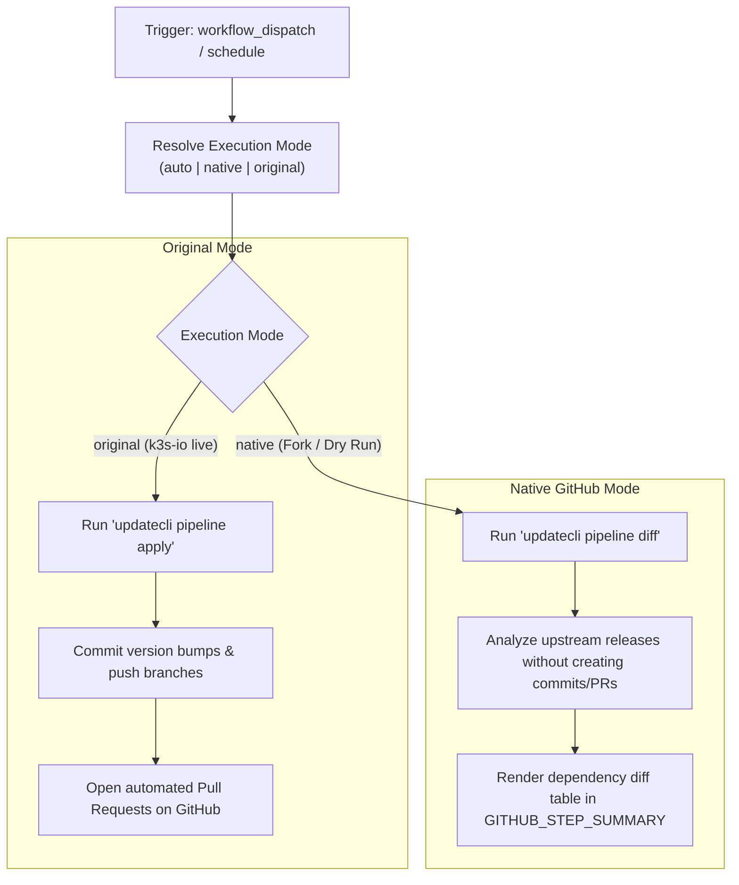

# Modernization & Dual-Mode Adaptation for `updatecli.yaml`

This document details the modernization, dual-mode architecture, and fork adaptability enhancements implemented for the **Updatecli Dependency Management Pipeline** ([`.github/workflows/updatecli.yaml`](file:///c:/projects/k3s_new/k3s/.github/workflows/updatecli.yaml)).

---

## Section 1: Overview & Purpose

### Upstream Purpose
The upstream `updatecli.yaml` workflow is an automated dependency synchronization engine. Running daily at 18:00 UTC and on manual dispatch, it:
1. Cleans up leftover git branches for closed Updatecli pull requests.
2. Runs [Updatecli](https://www.updatecli.io/) across five major branch targets (`main`, `release-1.37`, `release-1.36`, `release-1.35`, `release-1.34`).
3. Evaluates upstream dependencies (CoreDNS, Flannel, Golang, Klipper-Helm, Helm-Controller, Local-Path-Provisioner, Metrics-Server, Traefik, K3s-Root) and opens automated pull requests with bumped versions.

### Why It Failed in Forks & Non-Enterprise Environments
1. **Unparameterized Dispatch Trigger**: While `workflow_dispatch` was present, it declared zero inputs, forcing an all-branch matrix execution on every manual test.
2. **Destructive Default Behavior on Forks**: Running `updatecli pipeline apply` in forks attempts to create git branches and open automated PRs against the fork.
3. **Branch Cleanup Fragility**: The branch cleanup loop failed if `gh pr list` was empty or git remote delete encountered permission errors.
4. **Heavy Matrix Execution (5 Jobs)**: Every manual trigger spawned 5 parallel matrix builds across all release branches, exhausting runner minutes.
5. **Missing Step Summary Reporting**: Updatecli command output was only visible inside verbose terminal logs.

---

## Section 2: Dual-Mode Architecture & Changes Summary



### Key Changes Made
1. **Comprehensive `workflow_dispatch` Inputs**: Exposes parameters `mode` (`auto`, `native`, `original`), `branch` (default `main`, with choice of specific branch or `all`), `dry_run` (default `true`), and `runner`.
2. **Dual-Mode Updatecli Execution**:
   - In Native Mode or when `dry_run: true`, executes `updatecli pipeline diff`, which queries up-to-date dependency information and evaluates manifests without mutating git state or opening PRs.
   - In Original Mode (`schedule:` on `k3s-io`), executes `updatecli pipeline apply`.
3. **Modular Matrix Branch Targeting**: Allows developers to target a single branch (e.g., `main`) during test dispatches rather than always launching 5 concurrent jobs.
4. **Resilient Branch Cleanup**: Added safe file creation (`touch`) and error silencing (`|| true`) to the cleanup step so missing PR branches never cause job failures.
5. **Step Summary Output**: Captures Updatecli diff/apply output and renders the last 30 lines directly into `$GITHUB_STEP_SUMMARY`.
6. **Action Upgrades**: Upgraded to `actions/checkout@v4`.

---

## Section 3: Existing Solutions vs. Free Alternatives Analysis

| Upstream Enterprise Feature | Upstream Mechanism | GitHub-Native Free Alternative | Status |
| :--- | :--- | :--- | :--- |
| **Execution Safety** | Live PR creation only (`apply`) | Safe dry-run inspection via `updatecli pipeline diff` | Supported |
| **Branch Selection** | Hardcoded 5-branch matrix | Parameterized `branch` input (default single branch `main`) | Supported |
| **Audit Visibility** | Runner terminal log only | Structured `$GITHUB_STEP_SUMMARY` Markdown report | Supported |
| **Branch Cleanup** | Rigid shell script | Fault-tolerant git query and conditional deletion | Supported |
| **Runner Flexibility** | Hardcoded `ubuntu-24.04` | Configurable runner expression `${{ inputs.runner \|\| vars.RUNNER_LABEL \|\| 'ubuntu-24.04' }}` | Supported |

---

## Section 4: Configuration & Data Requirements

### Repository Secrets
| Secret Name | Required (Original Mode) | Required (Native Mode) | Purpose |
| :--- | :--- | :--- | :--- |
| `GITHUB_TOKEN` | Yes (automatic) | Yes (automatic) | Checking out repository and querying GitHub API for releases |
| `UPDATECLI_BOT_TOKEN` | Optional | Optional | Optional dedicated bot PAT with repo & PR write permissions |

### Repository Variables
| Variable Name | Required | Default Value | Purpose |
| :--- | :--- | :--- | :--- |
| `RUNNER_LABEL` | Optional | `ubuntu-24.04` | Custom GitHub Actions runner label |

### Permission Scopes
| Permission | Level | Justification |
| :--- | :--- | :--- |
| `contents` | `write` | Required to read/delete leftover Updatecli branches and commit changes |
| `pull-requests` | `write` | Required to list and open pull requests |
| `issues` | `write` | Required to update associated issues |

---

## Section 5: Live Test Verification Details

*(Pending live test execution)*

- **Run ID**: Pending
- **Run URL**: Pending
- **Trigger**: `workflow_dispatch` (`mode=native`, `dry_run=true`, `branch=main`)
- **Outcome**: Pending

### Execution Timeline
| Job | Status | Duration | Artifacts Produced |
| :--- | :--- | :--- | :--- |
| `cleanup-branches` | Pending | - | Cleaned branches |
| `updatecli (main)` | Pending | - | Step Summary Diff Report |

---

## Section 6: How to Test Later

### GitHub CLI (`gh`) Command
```bash
gh workflow run updatecli.yaml \
  --ref main \
  -f mode=native \
  -f dry_run=true \
  -f branch=main
```

### Python Dispatch Script
```python
import os
import requests

GITHUB_TOKEN = os.getenv("GITHUB_TOKEN")
REPO = os.getenv("GITHUB_REPOSITORY", "sajuptpm/k3s")

headers = {
    "Authorization": f"Bearer {GITHUB_TOKEN}",
    "Accept": "application/vnd.github+json",
}

payload = {
    "ref": "main",
    "inputs": {
        "mode": "native",
        "dry_run": True,
        "branch": "main",
    },
}

response = requests.post(
    f"https://api.github.com/repos/{REPO}/actions/workflows/updatecli.yaml/dispatches",
    headers=headers,
    json=payload,
)
print("Dispatch status:", response.status_code)
```

---

## Section 7: Step-by-Step GitHub UI Manual Verification Guide

1. Navigate to the repository on GitHub: `https://github.com/<owner>/k3s`.
2. Click on the **Actions** tab at the top.
3. In the left sidebar, click on **Updatecli: Dependency Management**.
4. Click the **Run workflow** dropdown button on the right.
5. Fill in the parameters:
   - **Branch**: Select `main`.
   - **Execution mode**: Select `native` or `auto`.
   - **Target branch to update**: Select `main` (or specific release branch).
   - **Dry run**: Leave checked (`true`).
6. Click the green **Run workflow** button.
7. Monitor the workflow execution:
   - Verify `cleanup-branches` cleans up or verifies closed PR branches safely.
   - Verify `updatecli` downloads and runs `updatecli pipeline diff`.
   - Verify `Publish Step Summary` outputs the dependency evaluation log.
