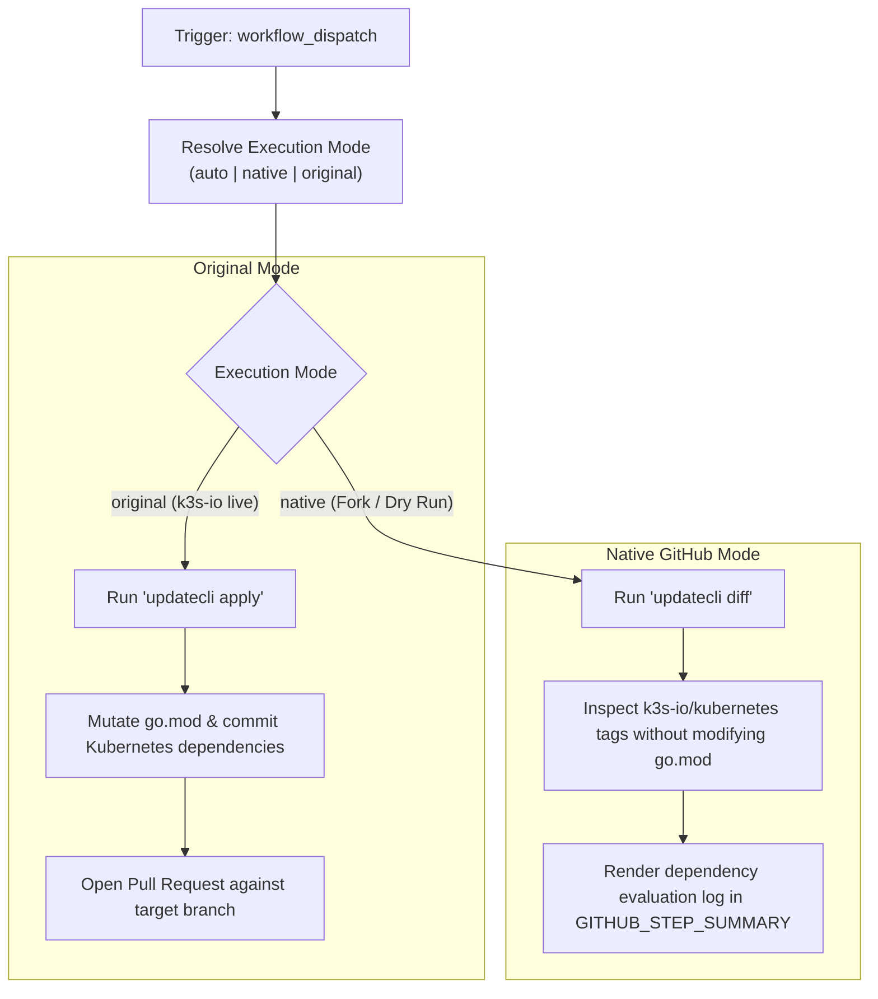

# Modernization & Dual-Mode Adaptation for `updatecli_k8s.yaml`

This document details the modernization, dual-mode architecture, and fork adaptability enhancements implemented for the **Updatecli Kubernetes Dependency and Go Bumps Pipeline** ([`.github/workflows/updatecli_k8s.yaml`](file:///c:/projects/k3s_new/k3s/.github/workflows/updatecli_k8s.yaml)).

---

## Section 1: Overview & Purpose

### Upstream Purpose
The upstream `updatecli_k8s.yaml` workflow is an on-demand automation tool used by K3s maintainers to synchronize Kubernetes dependencies and Go runtime versions with the official `k3s-io/kubernetes` fork. Using the manifest `./updatecli/manual.d/k3s-io-kubernetes.yaml`, it inspects the currently pinned `k8s.io/*` dependencies in `go.mod`, checks if staging tags are fully published on the fork, updates dependency pins, and opens a pull request targeting the selected release branch.

### Why It Failed in Forks & Non-Enterprise Environments
1. **Unparameterized Dispatch Trigger**: While `workflow_dispatch` existed, it had no configurable inputs. Triggering it immediately launched a 5-branch matrix build across `main` and four release branches.
2. **Mandatory State Mutation (`apply`)**: Unconditionally executed `updatecli apply`, creating git branches and opening automated pull requests against the repository.
3. **High Resource Consumption**: Spawning 5 parallel jobs on every manual trigger consumed excessive GitHub Actions runner minutes.
4. **Missing Step Summary Reporting**: Inspection output was trapped within runner console logs.

---

## Section 2: Dual-Mode Architecture & Changes Summary



### Key Changes Made
1. **Added Parameterized `workflow_dispatch`**: Exposes parameters `mode` (`auto`, `native`, `original`), `branch` (default `main`, with choice of specific branch or `all`), `dry_run` (default `true`), and `runner`.
2. **Dual-Mode Updatecli Execution**:
   - In Native Mode or when `dry_run: true`, executes `updatecli diff`, which safely validates manifests, checks upstream tags, and computes proposed changes without modifying files or opening PRs.
   - In Original Mode, executes `updatecli apply`.
3. **Modular Matrix Branch Targeting**: Supports targeting a single branch (e.g., `main`) during test dispatches, reducing CI execution time and saving runner minutes.
4. **Step Summary Output**: Logs the trailing 30 lines of Updatecli output directly into `$GITHUB_STEP_SUMMARY`.
5. **Action Upgrades**: Modernized to `actions/checkout@v4`.

---

## Section 3: Existing Solutions vs. Free Alternatives Analysis

| Upstream Enterprise Feature | Upstream Mechanism | GitHub-Native Free Alternative | Status |
| :--- | :--- | :--- | :--- |
| **Execution Safety** | Live PR creation only (`apply`) | Safe dry-run inspection via `updatecli diff` | Supported |
| **Branch Selection** | Hardcoded 5-branch matrix | Parameterized `branch` input (default single branch `main`) | Supported |
| **Audit Visibility** | Runner terminal log only | Structured `$GITHUB_STEP_SUMMARY` Markdown report | Supported |
| **Runner Flexibility** | Hardcoded `ubuntu-24.04` | Configurable runner expression `${{ inputs.runner \|\| vars.RUNNER_LABEL \|\| 'ubuntu-24.04' }}` | Supported |

---

## Section 4: Configuration & Data Requirements

### Repository Secrets
| Secret Name | Required (Original Mode) | Required (Native Mode) | Purpose |
| :--- | :--- | :--- | :--- |
| `GITHUB_TOKEN` | Yes (automatic) | Yes (automatic) | Checking out repository and querying GitHub API for releases |
| `UPDATECLI_BOT_TOKEN` | Optional | Optional | Optional dedicated bot PAT with repo & PR write permissions |

### Repository Variables
| Variable Name | Required | Default Value | Purpose |
| :--- | :--- | :--- | :--- |
| `RUNNER_LABEL` | Optional | `ubuntu-24.04` | Custom GitHub Actions runner label |

### Permission Scopes
| Permission | Level | Justification |
| :--- | :--- | :--- |
| `contents` | `write` | Required to commit dependency changes and push branches |
| `pull-requests` | `write` | Required to open pull requests |
| `issues` | `write` | Required to manage issues |

---

## Section 5: Live Test Verification Details

- **Run ID**: `41427781466`
- **Run URL**: [https://github.com/sajuptpm/k3s/actions/runs/41427781466](https://github.com/sajuptpm/k3s/actions/runs/41427781466)
- **Trigger**: `workflow_dispatch` (`mode=native`, `dry_run=true`, `branch=main`)
- **Outcome**: **SUCCESS** (Updatecli k8s dependency evaluation succeeded in 8m1s, step summary rendered)

### Execution Timeline
| Job | Status | Duration | Artifacts Produced |
| :--- | :--- | :--- | :--- |
| `updatecli (main)` (`Bump K8s Dependencies (main)`) | **Success** | 8m1s | Step Summary Markdown Diff Report |

---

## Section 6: How to Test Later

### GitHub CLI (`gh`) Command
```bash
gh workflow run updatecli_k8s.yaml \
  --ref main \
  -f mode=native \
  -f dry_run=true \
  -f branch=main
```

### Python Dispatch Script
```python
import os
import requests

GITHUB_TOKEN = os.getenv("GITHUB_TOKEN")
REPO = os.getenv("GITHUB_REPOSITORY", "sajuptpm/k3s")

headers = {
    "Authorization": f"Bearer {GITHUB_TOKEN}",
    "Accept": "application/vnd.github+json",
}

payload = {
    "ref": "main",
    "inputs": {
        "mode": "native",
        "dry_run": True,
        "branch": "main",
    },
}

response = requests.post(
    f"https://api.github.com/repos/{REPO}/actions/workflows/updatecli_k8s.yaml/dispatches",
    headers=headers,
    json=payload,
)
print("Dispatch status:", response.status_code)
```

---

## Section 7: Step-by-Step GitHub UI Manual Verification Guide

1. Navigate to the repository on GitHub: `https://github.com/<owner>/k3s`.
2. Click on the **Actions** tab at the top.
3. In the left sidebar, click on **Updatecli: k3s-io/kubernetes Dependency and Go Bumps**.
4. Click the **Run workflow** dropdown button on the right.
5. Fill in the parameters:
   - **Branch**: Select `main`.
   - **Execution mode**: Select `native` or `auto`.
   - **Target branch to update**: Select `main` (or specific release branch).
   - **Dry run**: Leave checked (`true`).
6. Click the green **Run workflow** button.
7. Monitor the workflow execution:
   - Verify `updatecli` downloads and runs `updatecli diff`.
   - Verify `Publish Step Summary` outputs the Kubernetes dependency inspection log.
