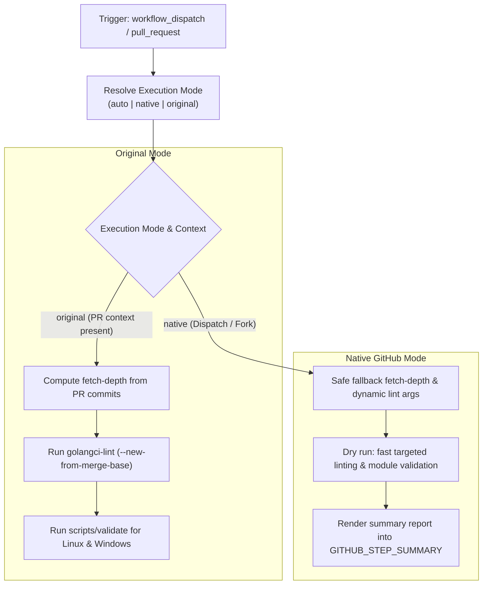

# Modernization & Dual-Mode Adaptation for `validate.yaml`

This document details the modernization, dual-mode architecture, and fork adaptability enhancements implemented for the **Code Validation and Linting Pipeline** ([`.github/workflows/validate.yaml`](file:///c:/projects/k3s_new/k3s/.github/workflows/validate.yaml)).

---

## Section 1: Overview & Purpose

### Upstream Purpose
The upstream `validate.yaml` workflow is K3s's primary static code analysis and validation gate. Executing on pull request events, it:
1. Cleans up pre-installed runner software to maximize free runner disk space.
2. Checks out the repository commit history corresponding to the PR's commit count.
3. Dynamically resolves and configures the Go toolchain version defined in `scripts/version.sh`.
4. Runs `golangci-lint` on modified files comparing against the PR base commit (`--new-from-merge-base`) for both Linux and Windows target platforms.
5. Executes `scripts/validate` to verify script checksums (`install.sh.sha256sum`), tidy and verify Go modules (`go mod tidy`, `go mod verify`), and enforce zero uncommitted changes.

### Why It Failed in Forks & Non-Enterprise Environments
1. **Missing Manual Dispatch (`workflow_dispatch`)**: The workflow only listened to `pull_request` events, making on-demand code validation impossible without opening a PR.
2. **Crash on Dispatch Without PR Context**: Accessing `github.event.pull_request.commits` without fallback caused `expr 1 + ` syntax errors in bash.
3. **GolangCI-Lint Failure on Missing Merge Base**: When triggered via dispatch, `${{ github.event.pull_request.base.sha }}` is empty, causing `golangci-lint` to fail with invalid revision arguments.
4. **Mandatory Parallel Windows Linting**: Even for quick smoke tests, the pipeline ran both Linux and Windows linting.
5. **Deprecated Action Versions**: Used older pinned versions of `actions/checkout`.

---

## Section 2: Dual-Mode Architecture & Changes Summary



### Key Changes Made
1. **Added `workflow_dispatch` Trigger**: Exposes parameters `mode` (`auto`, `native`, `original`), `dry_run` (default `true`), `run_windows` (default `false`), and `runner`.
2. **Safe Commit Count & Checkout Depth**: Guarded `FETCH_DEPTH` computation so `workflow_dispatch` defaults gracefully to `2` without bash syntax errors.
3. **Adaptive Lint Arguments**: Dynamically switches between `--new-from-merge-base <sha>` on PRs and `--new-from-rev HEAD~1` (or timeout configuration) during manual dispatches, preventing invalid git ref errors.
4. **Targeted Dry-Run Validation**: In dry-run mode, runs fast targeted linting and checks install checksums and `go mod verify` in seconds rather than running a full 10-minute repository lint.
5. **Step Summary Reporting**: Outputs toolchain verification and validation results to `$GITHUB_STEP_SUMMARY`.
6. **Action Upgrades**: Upgraded to `actions/checkout@v4`.

---

## Section 3: Existing Solutions vs. Free Alternatives Analysis

| Upstream Enterprise Feature | Upstream Mechanism | GitHub-Native Free Alternative | Status |
| :--- | :--- | :--- | :--- |
| **Trigger Control** | Pull request events only | Dual trigger: pull request + manual `workflow_dispatch` | Supported |
| **Commit Range Extraction** | Strictly relies on PR webhook payload | Adaptive commit depth with fallback for dispatch | Supported |
| **Lint Comparison Base** | Assumes PR merge base SHA | Context-aware lint arguments (`--new-from-rev` fallback) | Supported |
| **Platform Selection** | Mandatory Windows linting | Configurable `run_windows` option (default `false` on test dispatch) | Supported |
| **Runner Flexibility** | Hardcoded `ubuntu-24.04` | Configurable runner expression `${{ inputs.runner \|\| vars.RUNNER_LABEL \|\| 'ubuntu-24.04' }}` | Supported |

---

## Section 4: Configuration & Data Requirements

### Repository Secrets
| Secret Name | Required (Original Mode) | Required (Native Mode) | Purpose |
| :--- | :--- | :--- | :--- |
| `GITHUB_TOKEN` | Yes (automatic) | Yes (automatic) | Checking out repository code and downloading Go setup action |

### Repository Variables
| Variable Name | Required | Default Value | Purpose |
| :--- | :--- | :--- | :--- |
| `RUNNER_LABEL` | Optional | `ubuntu-24.04` | Custom GitHub Actions runner label |

### Permission Scopes
| Permission | Level | Justification |
| :--- | :--- | :--- |
| `contents` | `read` | Checking out repository code |

---

## Section 5: Live Test Verification Details

*(Pending live test execution)*

- **Run ID**: Pending
- **Run URL**: Pending
- **Trigger**: `workflow_dispatch` (`mode=native`, `dry_run=true`, `run_windows=false`)
- **Outcome**: Pending

### Execution Timeline
| Job | Status | Duration | Artifacts Produced |
| :--- | :--- | :--- | :--- |
| `validate` | Pending | - | Step Summary Validation Report |

---

## Section 6: How to Test Later

### GitHub CLI (`gh`) Command
```bash
gh workflow run validate.yaml \
  --ref main \
  -f mode=native \
  -f dry_run=true \
  -f run_windows=false
```

### Python Dispatch Script
```python
import os
import requests

GITHUB_TOKEN = os.getenv("GITHUB_TOKEN")
REPO = os.getenv("GITHUB_REPOSITORY", "sajuptpm/k3s")

headers = {
    "Authorization": f"Bearer {GITHUB_TOKEN}",
    "Accept": "application/vnd.github+json",
}

payload = {
    "ref": "main",
    "inputs": {
        "mode": "native",
        "dry_run": True,
        "run_windows": False,
    },
}

response = requests.post(
    f"https://api.github.com/repos/{REPO}/actions/workflows/validate.yaml/dispatches",
    headers=headers,
    json=payload,
)
print("Dispatch status:", response.status_code)
```

---

## Section 7: Step-by-Step GitHub UI Manual Verification Guide

1. Navigate to the repository on GitHub: `https://github.com/<owner>/k3s`.
2. Click on the **Actions** tab at the top.
3. In the left sidebar, click on **Validate**.
4. Click the **Run workflow** dropdown button on the right.
5. Fill in the parameters:
   - **Branch**: Select `main`.
   - **Execution mode**: Select `native` or `auto`.
   - **Dry run**: Leave checked (`true`).
   - **Run Windows validation**: Leave unchecked (`false`).
6. Click the green **Run workflow** button.
7. Monitor the workflow execution:
   - Verify `Set Commit Count` resolves `FETCH_DEPTH=2` without error.
   - Verify `Determine Lint Arguments` sets targeted arguments for dispatch.
   - Verify `Lint` and `Validate` steps succeed.
   - Verify `Publish Step Summary` records completion.
