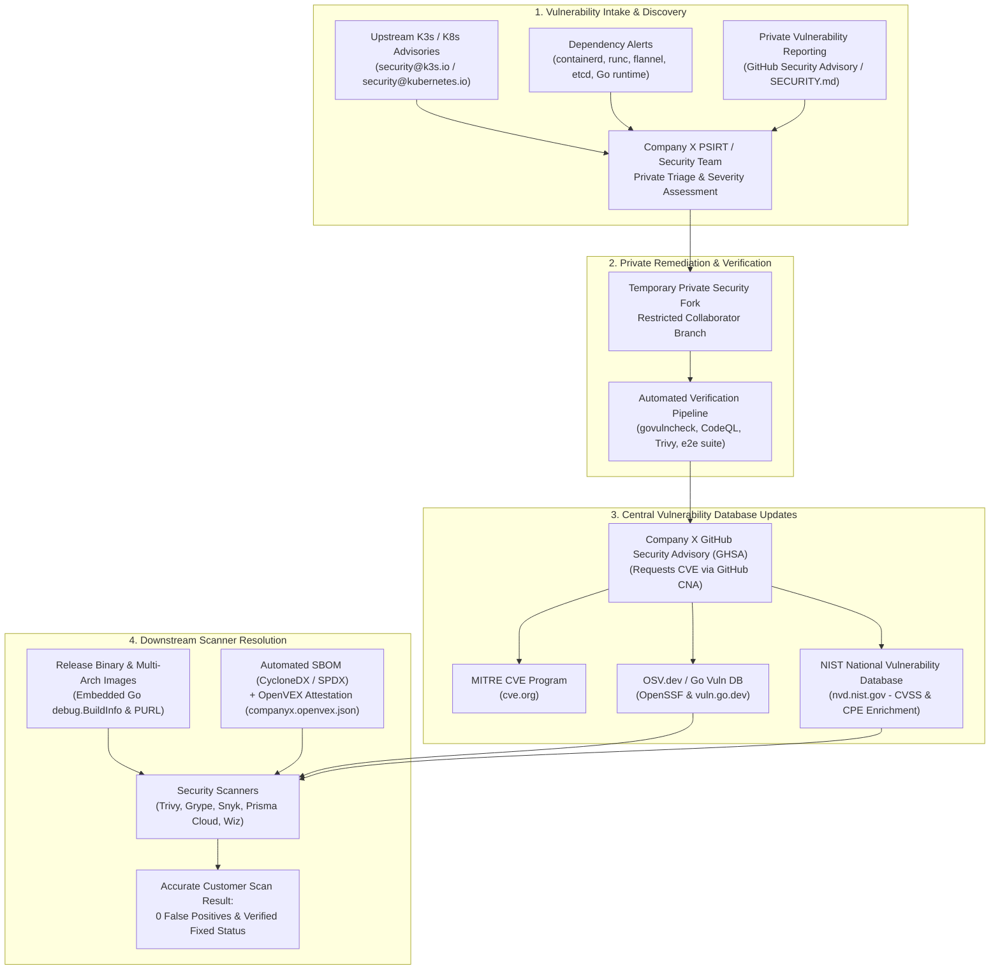
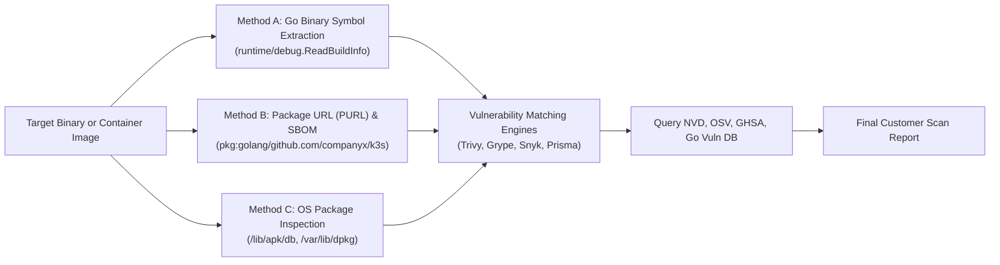
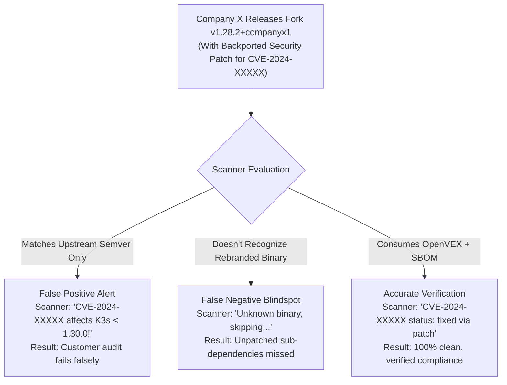

# Vulnerability Management, Central CVE Database Publishing, and Scanner Identification Strategy for Company X K3s Fork

## Executive Summary

When **Company X** forks the K3s repository and releases an enterprise-grade Kubernetes distribution under Company X's brand name (e.g., `CompanyX K3s` or `X-Kubernetes`), managing security vulnerabilities, updating central registries, and ensuring downstream customer scanners accurately evaluate the software are vital operational duties.

This document establishes the end-to-end strategy, operational playbooks, and technical standards for:
1. **Managing the Vulnerability Repository & Incident Response** (Security policies, private reporting, triage tiers, and internal VEX repositories).
2. **Publishing Fixes to Central Vulnerability Databases** (MITRE CVE, NIST NVD, GitHub Advisory Database / GHSA, Google/OpenSSF OSV, and the Go Vulnerability Database).
3. **Resolving the "Fork Scanner Dilemma"** (Preventing scanner false positives on backported fixes and false negatives on rebranded packages using Go `BuildInfo`, CycloneDX/SPDX SBOMs, and OpenVEX attestations).

---

## 1. End-to-End Vulnerability Lifecycle Architecture



---

## 2. Managing Company X's Vulnerability Repository & Operations

Operating a reputable downstream distribution requires formalizing ingestion, response SLAs, and a structured disclosure framework.

### 2.1 Security Policy Configuration (`.github/SECURITY.md`)
Company X must replace the upstream Rancher security contact in [`.github/SECURITY.md`](file:///c:/projects/k3s_new/k3s/.github/SECURITY.md) with Company X's corporate security infrastructure:
- **Designated Contact**: Dedicated security alias (e.g., `security@companyx.com` or `psirt@companyx.com`).
- **Cryptographic Channel**: GPG Public Key ID and fingerprint for encrypted vulnerability reports.
- **Service Level Agreements (SLAs)**:
  - *Initial Acknowledgment*: Within 24–48 business hours.
  - *Severity Assessment & Reproduction*: Within 5 business days.
  - *Target Remediation Window*: Critical (CVSS ≥ 9.0) ≤ 14 days; High (CVSS 7.0–8.9) ≤ 30 days; Medium/Low ≤ 60–90 days.
- **Coordinated Disclosure Policy**: Request researchers to adhere to an industry-standard 90-day coordinated vulnerability disclosure (CVD) window prior to public disclosure.

### 2.2 GitHub Private Vulnerability Reporting
Company X must activate GitHub's built-in **Private Vulnerability Reporting**:
1. Navigate to `https://github.com/companyx/k3s/settings/security_analysis`.
2. Enable **Private vulnerability reporting**.
3. When security researchers, enterprise customers, or white-hat analysts discover a potential exploit, they submit the report through a private form on the repository. This automatically opens a private advisory workspace visible only to Company X repository maintainers and the reporter.

### 2.3 The Three Triage Classes

Vulnerabilities discovered in Company X's K3s fork fall into three distinct operational categories, each requiring a specific remediation and disclosure path:

| Triage Class | Description & Typical Components | Operational Remediation Protocol | Public CVE Assignment Role |
|---|---|---|---|
| **Class 1: Upstream K3s / Kubernetes Flaws** | Flaws in upstream supervisor logic, tunneling, control plane, or Kubernetes kube-apiserver / kubelet. | Track upstream Rancher/SUSE announcements. Cherry-pick / backport fix commits from `k3s-io/k3s` into Company X's release branches (`release-1.30`, etc.). | Upstream Rancher or Kubernetes CNA already assigns the CVE. Company X **cites the existing CVE** in release notes and OpenVEX. |
| **Class 2: Embedded Third-Party Dependencies** | Vulnerabilities in embedded components: `containerd`, `runc`, `flannel`, `kine`, `etcd`, `sqlite`, or the Go compiler runtime. | Bump dependency versions in `go.mod`, rebuild container base images, and rerun automated regression tests (`validate.yaml`, `e2e.yaml`). | Upstream dependency vendor assigns the CVE. Company X documents the updated dependency version in release notes and OpenVEX. |
| **Class 3: Company X Custom Code Flaws** | Flaws in Company X proprietary enhancements, custom authentication plugins, modified installer scripts, or storage drivers. | Develop patch in GitHub Temporary Private Fork. Conduct peer review, run unit/e2e CI tests, merge to release branch upon advisory publication. | **Company X must request a new CVE** via GitHub CNA or MITRE and publish an advisory. |

### 2.4 Internal VEX Hub Repository (`companyx/vexhub`)
Upstream K3s utilizes OpenVEX reports downloaded from Rancher's VEX repository ([`.github/workflows/trivy-scan.yml#L129-L136`](file:///c:/projects/k3s_new/k3s/.github/workflows/trivy-scan.yml#L129-L136)). 

Company X must establish an equivalent central VEX repository (`github.com/companyx/vexhub`):
- Maintain an authoritative file `companyx.openvex.json`.
- Document every scanner-flagged CVE in third-party libraries (e.g., standard library Go CVEs or base OS packages).
- Provide machine-readable justifications (`vulnerable_code_not_present`, `inline_mitigation_already_applied`, or `fixed`).
- Supply this VEX file to downstream customers so their container scanning tools automatically suppress false positives.

---

## 3. How Company X Updates Central Vulnerability Databases

Vulnerability scanners do not parse git commits or PDF release notes. They ingest structured machine-readable records from centralized authoritative databases:
- **MITRE CVE Program** (`cve.org`)
- **NIST National Vulnerability Database (NVD)** (`nvd.nist.gov`)
- **GitHub Advisory Database (GHSA)** (`github.com/advisories`)
- **Google / OpenSSF OSV Database** (`osv.dev`)
- **Go Vulnerability Database** (`vuln.go.dev`)

### 3.1 Method 1: GitHub Security Advisory -> Automatic Global CVE Propagation (Recommended)

GitHub is an authorized **CVE Numbering Authority (CNA)**. For open-source repositories hosted on GitHub, this provides the most reliable, zero-cost, and globally integrated path to update all central databases simultaneously.

```mermaid
sequenceDiagram
    autonumber
    actor Reporter as Security Researcher / Dev
    participant GHSA as Company X Repo (/security/advisories)
    participant GH_CNA as GitHub CNA Authority
    participant MITRE as MITRE CVE Program (cve.org)
    participant NVD as NIST NVD (nvd.nist.gov)
    participant OSV as OSV.dev & Go Vuln DB

    Reporter->>GHSA: Submits private vulnerability draft
    GHSA->>GHSA: Security team verifies issue; creates Temporary Private Fork
    GHSA->>GHSA: Commits fix; runs CI testing
    GHSA->>GH_CNA: Clicks "Request CVE identification" in Advisory form
    GH_CNA-->>GHSA: Allocates CVE-YYYY-NNNNN (Reserved)
    GHSA->>GHSA: Tag release (e.g., v1.30.2+companyx1) and merges to public main
    GHSA->>GH_CNA: Clicks "Publish Advisory"
    par Automated Global Ecosystem Sync
        GH_CNA->>MITRE: Publishes official CVE record to cve.org
        GH_CNA->>NVD: Transmits CVE to NIST for CVSS scoring & CPE mapping
        GH_CNA->>OSV: Pushes standardized OSV JSON to osv.dev
        GH_CNA->>GHSA: Updates GitHub Advisory Database (triggers Dependabot)
    end
```

#### Step-by-Step Publishing Workflow:
1. Navigate to `https://github.com/companyx/k3s/security/advisories/new`.
2. Fill out the advisory form:
   - **Package Ecosystem**: `Go`
   - **Package Name**: `github.com/companyx/k3s` (or your declared Go module name)
   - **Affected Versions**: e.g., `>= 1.28.0, < 1.30.2+companyx1`
   - **Patched Version**: `1.30.2+companyx1`
   - **Severity / CVSS v3.1**: Enter vector string (e.g., `CVSS:3.1/AV:N/AC:L/PR:N/UI:N/S:U/C:H/I:H/A:H`).
   - **Common Weakness Enumeration (CWE)**: Select matching CWE (e.g., `CWE-287: Improper Authentication`).
3. Click **"Request CVE identification"**. GitHub will immediately allocate a reserved identifier from its assigned CNA block (e.g., `CVE-2026-34567`).
4. Link the fix PR from the temporary private fork.
5. Publish the release and click **"Publish advisory"**.
6. GitHub CNA transmits the CVE JSON 5.0 record to MITRE and NVD, making the fix searchable worldwide within 24–48 hours.

---

### 3.2 Method 2: Publishing to the Go Vulnerability Database (`vuln.go.dev`)

Because K3s is compiled in Go, developer security tooling like `govulncheck` queries the official Go Vulnerability Database.

1. Navigate to the Go vulnerability issue tracker: [golang/vulndb/issues](https://github.com/golang/vulndb/issues/new?template=new_data_report.yml).
2. Submit a report referencing Company X's module:
   ```yaml
   module: github.com/companyx/k3s
   package: github.com/companyx/k3s/pkg/cli/server
   versions:
     - fixed: 1.30.2+companyx1
   cve: CVE-2026-34567
   ghsa: GHSA-xxxx-yyyy-zzzz
   summary: "Unauthenticated privilege escalation in Company X K3s server CLI"
   description: "A vulnerability in Company X K3s allows remote users to bypass RBAC..."
   ```
3. Once accepted by the Go Security Team, `govulncheck` immediately recognizes that Company X version `1.30.2+companyx1` contains the fix.

---

### 3.3 Method 3: Upstream Coordinated Vulnerability Disclosure (CVD)

If Company X discovers a zero-day vulnerability located in shared upstream code (e.g., Rancher K3s supervisor or Kubernetes core):
1. **Never disclose publicly first**: Avoid requesting a CVE or publishing a public PR.
2. **Contact Upstream Teams Under Embargo**:
   - Upstream K3s: Email `security@k3s.io` / `security@rancher.com`.
   - Core Kubernetes: Follow the [Kubernetes Security Disclosure Process](https://kubernetes.io/docs/reference/issues-security/security/) via `security@kubernetes.io`.
3. **Harmonize Release Schedules**: Agree on an embargo termination date (typically 30–90 days). Upstream assigns the CVE. On disclosure day, both Upstream K3s and Company X release patched builds simultaneously citing the same CVE ID.

---

## 4. How Vulnerability Scanners Identify Issues in Company X's Fork

To ensure customer scanners (Trivy, Grype, Snyk, Palo Alto Prisma Cloud, Wiz, Qualys, Rapid7) accurately recognize vulnerabilities—and just as importantly, recognize **fixes**—it is essential to understand scanner detection mechanics.

### 4.1 Scanner Inspection Mechanics

Scanners use three distinct methods to discover vulnerabilities:



1. **Go Binary Symbol & BuildInfo Extraction**:
   - The Go compiler automatically embeds module paths, build flags, commit SHAs, and dependencies into compiled binaries.
   - Scanners execute `debug.ReadBuildInfo()` on `/usr/local/bin/k3s`.
   - If Company X retains `module github.com/k3s-io/k3s` in `go.mod`, scanners treat it as upstream Rancher K3s.
   - If Company X renames the module to `github.com/companyx/k3s`, scanners search databases for records registered under `github.com/companyx/k3s`.
2. **Package URLs (PURL) & SBOMs**:
   - Modern scanners ingest Software Bills of Materials (SBOMs) packaged with container images.
   - They parse PURLs such as `pkg:golang/github.com/companyx/k3s@1.30.2%2Bcompanyx1` and match them against OSV/NVD feeds.
3. **CPE (Common Platform Enumeration) Matching**:
   - Legacy enterprise scanners (Nessus, Qualys) map software banners to CPE strings (e.g., `cpe:2.3:a:rancher:k3s:1.30.2`).
   - If a binary reports an unrecognized custom banner (`CompanyX-K3s v1.0.0`), CPE scanners fail to match unless custom CPE dictionaries or dependency signatures are used.

---

### 4.2 The "Fork Scanner Dilemma"

When maintaining a commercial fork, two major scanning errors can occur:



1. **False Positives (The Backport Trap)**:
   - Upstream fixes a vulnerability in `v1.30.0`.
   - Company X supports enterprise customers on `v1.28.x` and backports the patch into `v1.28.2+companyx1`.
   - Scanners that only perform naive version string matching check NVD, see `affected: < 1.30.0`, and raise a **Critical CVE alert**, failing customer compliance checks even though the code is secure.
2. **False Negatives (The Rebranding Blindspot)**:
   - Company X completely renames all package references to `companyx-k3s`.
   - If Company X has not published corresponding advisories to OSV/NVD for `companyx-k3s`, scanners find 0 CVEs in the database and report a clean bill of health even if an unpatched vulnerability exists.

---

### 4.3 The 3-Pillar Solution for Company X

To eliminate both false positives and false negatives, Company X must adopt these three industry standards in its build and release pipelines:

#### Pillar 1: Lineage-Preserving Semantic Versioning
Preserve upstream lineage in your versioning convention using SemVer build metadata:
- **Format**: `v<Upstream-K8s-Version>+<CompanyX-Revision>`
- **Example**: `v1.30.2+companyx1`
- **Impact**: Informs both human operators and automated tools of the upstream Kubernetes baseline while distinctly identifying Company X's specific build revision.

#### Pillar 2: Automated CycloneDX / SPDX SBOM Generation
Generate a comprehensive **Software Bill of Materials (SBOM)** during the release build workflow ([`.github/workflows/release.yaml`](file:///c:/projects/k3s_new/k3s/.github/workflows/release.yaml)).

Using tools like `syft`:
```bash
syft packages dir:dist/artifacts -o cyclonedx-json=companyx-k3s-sbom.cdx.json
```
Publish `companyx-k3s-sbom.cdx.json` as an official GitHub Release asset and attach it as an OCI attestation to your container images using `cosign`:
```bash
cosign attest --yes --predicate companyx-k3s-sbom.cdx.json --type cyclonedx ghcr.io/companyx/k3s:v1.30.2-companyx1
```

#### Pillar 3: Machine-Readable OpenVEX Attestation
Publish an **OpenVEX** document (`companyx.openvex.json`) with every release. OpenVEX is an international specification backed by OpenSSF and CISA designed specifically to convey exploitability and backported patch status directly to scanners like Trivy and Grype.

##### Production OpenVEX Template (`companyx.openvex.json`):
```json
{
  "@context": "https://openvex.dev/ns/v0.2.0",
  "@id": "https://github.com/companyx/k3s/releases/download/v1.30.2+companyx1/companyx.openvex.json",
  "author": "Company X Product Security Incident Response Team (PSIRT)",
  "role": "Project Maintainer and Vendor",
  "timestamp": "2026-11-06T12:00:00Z",
  "version": 1,
  "statements": [
    {
      "vulnerability": {
        "name": "CVE-2024-XXXXX"
      },
      "products": [
        {
          "@id": "pkg:golang/github.com/companyx/k3s@1.28.2+companyx1"
        }
      ],
      "status": "fixed",
      "statement": "Vulnerability patched via backported security commit 7b4a19c in Company X release v1.28.2+companyx1."
    },
    {
      "vulnerability": {
        "name": "CVE-2024-YYYYY"
      },
      "products": [
        {
          "@id": "pkg:golang/github.com/companyx/k3s@1.30.2+companyx1"
        }
      ],
      "status": "not_affected",
      "justification": "vulnerable_code_not_present",
      "impact_statement": "The vulnerable flannel encryption driver is disabled and not compiled into the Company X K3s binary."
    }
  ]
}
```

##### How Customers Scan with Company X's OpenVEX:
When customers scan Company X images with Trivy:
```bash
trivy image --vex companyx.openvex.json ghcr.io/companyx/k3s:v1.30.2-companyx1
```
Trivy evaluates the VEX statement, suppresses the false positive, and prints:
```text
CVE-2024-XXXXX: Fixed by vendor (VEX status: fixed)
CVE-2024-YYYYY: Not affected (VEX status: not_affected - vulnerable_code_not_present)
Total: 0 High, 0 Critical vulnerabilities
```

---

## 5. Implementation Blueprint & CI/CD Workflow Integration

Integrate automated SBOM generation and VEX validation directly into Company X's release workflow ([`.github/workflows/release.yaml`](file:///c:/projects/k3s_new/k3s/.github/workflows/release.yaml)):

```yaml
      # Step 1: Generate CycloneDX SBOM
      - name: Generate CycloneDX SBOM
        uses: anchore/sbom-action@v0.18.0
        with:
          path: ./dist/artifacts
          format: cyclonedx-json
          output-file: dist/artifacts/companyx-k3s-sbom.cdx.json

      # Step 2: Assemble OpenVEX Statement
      - name: Assemble OpenVEX Document
        run: |
          cat << 'EOF' > dist/artifacts/companyx.openvex.json
          {
            "@context": "https://openvex.dev/ns/v0.2.0",
            "@id": "https://github.com/companyx/k3s/releases/download/${{ github.ref_name }}/companyx.openvex.json",
            "author": "Company X PSIRT",
            "timestamp": "$(date -u +%Y-%m-%dT%H:%M:%SZ)",
            "version": 1,
            "statements": []
          }
          EOF

      # Step 3: Verify Container Image with Trivy + VEX
      - name: Run Trivy Verification Scan
        uses: aquasecurity/trivy-action@master
        with:
          image-ref: ghcr.io/${{ github.repository }}:${{ github.ref_name }}
          format: table
          exit-code: 1
          ignore-unfixed: true
          severity: 'CRITICAL,HIGH'
        env:
          TRIVY_VEX: dist/artifacts/companyx.openvex.json

      # Step 4: Attach SBOM and VEX to GitHub Release
      - name: Upload Release Assets
        uses: softprops/action-gh-release@v2.2.1
        with:
          files: |
            dist/artifacts/companyx-k3s-sbom.cdx.json
            dist/artifacts/companyx.openvex.json
            dist/artifacts/k3s*
```

---

## 6. Executive Action Checklist for Company X

| Milestone | Action Item | Target System / Tool | Deliverable |
|---|---|---|---|
| **Phase 1: Ingestion** | Update security email, PGP keys, and disclosure policy | [`.github/SECURITY.md`](file:///c:/projects/k3s_new/k3s/.github/SECURITY.md) | Published Security Policy |
| **Phase 1: Ingestion** | Enable private researcher disclosure forms | GitHub Repository Settings | Active Private Reporting |
| **Phase 2: Database Sync** | Request CVEs via GitHub CNA upon advisory creation | GitHub Security Advisories | Reserved `CVE-YYYY-NNNNN` |
| **Phase 2: Database Sync** | Submit fixed version metadata to Go Vulnerability Database | [golang/vulndb](https://github.com/golang/vulndb) | `vuln.go.dev` Entry |
| **Phase 2: Database Sync** | Coordinate upstream disclosures under embargo | `security@k3s.io` | Coordinated Disclosure Plan |
| **Phase 3: Scanner Support**| Embed Go buildinfo & Package URLs (`PURL`) | `go.mod` & Makefile | Valid `debug.ReadBuildInfo()` |
| **Phase 3: Scanner Support**| Generate and attach CycloneDX SBOM to releases | Syft / Anchore SBOM Action | `sbom.cdx.json` Release Asset |
| **Phase 3: Scanner Support**| Publish and attach machine-readable OpenVEX file | OpenVEX (`vexctl`) | `companyx.openvex.json` |
